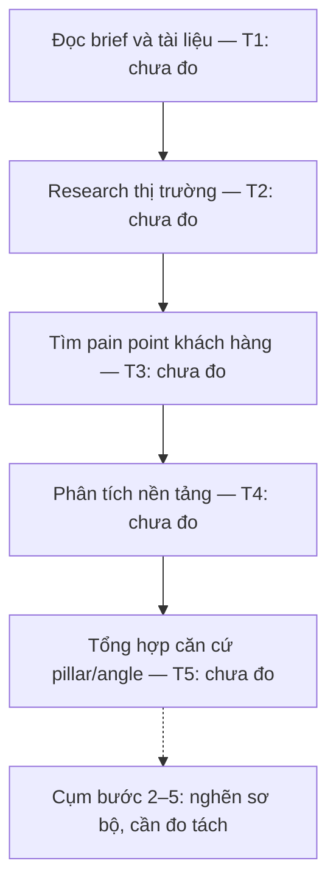
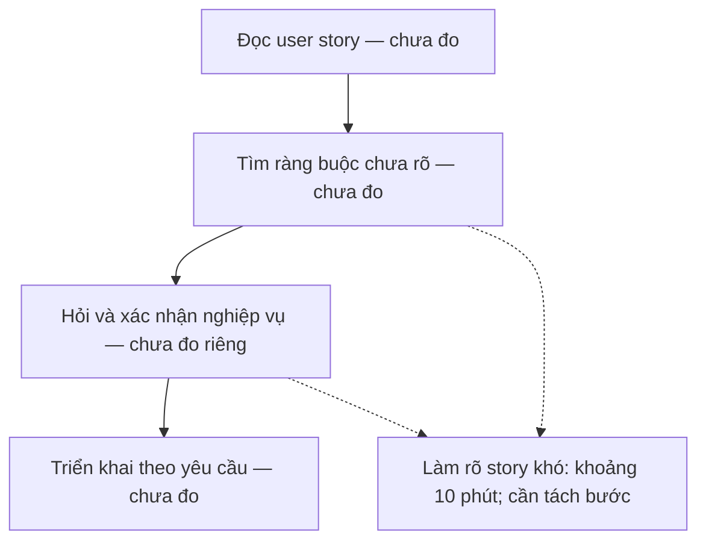
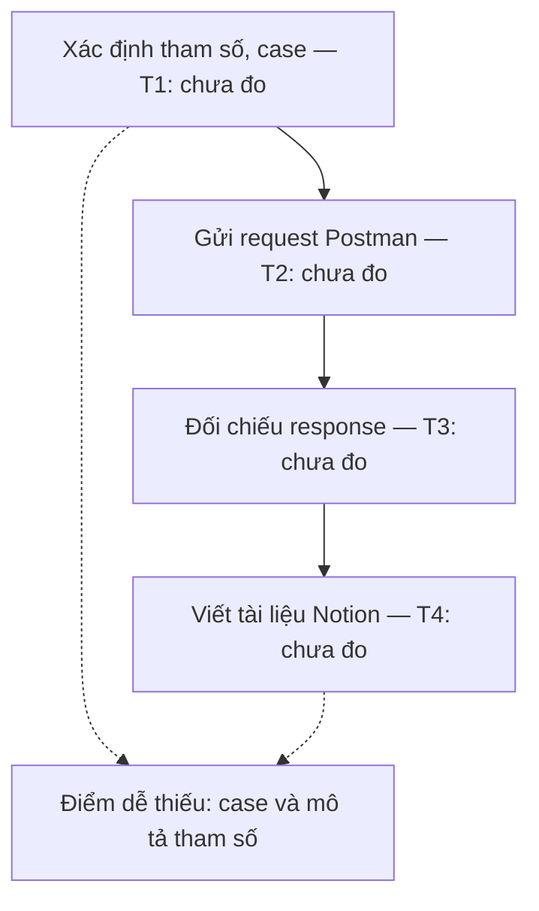

# Báo cáo cá nhân — 2A202603627_MaiDangKhuong

> Đổi tên file theo quy tắc `MSSV_HoTen.md`, ví dụ `20241234_NguyenVanAn.md` (MSSV trước, dấu `_`, họ tên viết liền không dấu). Sửa cả dòng tiêu đề phía trên cho khớp.
> Template chi tiết và prompt mẫu cho từng mục: [docs/01-worksheet.md](../../docs/01-worksheet.md).
> Mỗi thành viên một file trong `report/individual/` trên repo nhóm: copy template này thành file mới, điền, rồi commit bằng tài khoản GitHub của bạn. Không viết hộ người khác.

## 1. Thông tin học viên

- Họ tên: Mai Đăng Khương
- MSSV: 2A202603627
- Email trường (không bắt buộc, repo có thể để public): 26ai.khuongmd@vinuni.edu.vn
- Tên nhóm: TEAMLAGI
- Link repo nhóm: https://github.com/trongjhuongwr/K5-L3A-DAY02-TEAMLAGI-DiscoveryProblemFraming

---

## 2. Scan problem (CP1)

Lăng kính: **Lặp lại** · **Tốn thời gian** · **Cần đọc, tổng hợp nhiều thông tin** · **Pain từ người khác**.

| # | Lăng kính | Job Story: Khi… tôi muốn… để… | Ai chịu ảnh hưởng? | Dấu hiệu thật (thời gian, tần suất, số người, bằng chứng) |
|---:|---|---|---|---|
| 1 | Cần đọc, tổng hợp nhiều thông tin; Pain từ người khác | Khi nhận mong muốn, ý tưởng và tài liệu sản phẩm từ nhãn hàng, tôi muốn xác định nhu cầu thị trường, pain point/insight khách hàng và yếu tố giúp nội dung hiệu quả trên nền tảng, để xây dựng định hướng nội dung có cơ sở và kịp deadline. | Người làm nội dung tại công ty truyền thông giải trí, đồng thời làm freelancer (bạn của tôi). | Người bạn chia sẻ đã mất khoảng 2 ngày làm việc tập trung để research cho một job cụ thể; chưa xác định đây là thời gian điển hình cho mọi job. Theo người bạn, nhận nhiều job có thể dẫn đến trễ deadline; research chưa kỹ ảnh hưởng các bước làm nội dung về sau. Chưa có số liệu chuyển đổi/viral để kiểm chứng mức ảnh hưởng. |
| 2 | Cần đọc, tổng hợp nhiều thông tin | Khi lập kế hoạch học tập và dự án VinUni, tôi muốn tổng hợp yêu cầu từ slide bài giảng, video/slide workshop, email chương trình và nền tảng cohort thành checklist và mốc hoàn thành rõ ràng, để quản lý công việc cá nhân và nhóm mà không bỏ sót ý quan trọng. | Tôi trong vai trò học viên và người tham gia quản lý công việc nhóm. | Lần gần nhất mất khoảng 3 tiếng để tổng hợp slide, xem video và làm checklist. Hiện ghi việc trên giấy: trực quan nhưng tốn thời gian, khó quản lý và có nguy cơ mất ý nếu tổng hợp chưa kỹ. |
| 3 | Lặp lại | Khi viết daily standup cho dự án e-commerce, tôi muốn tổng hợp công việc đã làm thành báo cáo ngắn gọn và làm rõ bước tiếp theo hoặc những việc đang chờ yêu cầu, để nhóm nắm tiến độ và điểm cần hỗ trợ. | Tôi, backend developer trong dự án e-commerce. | Mất khoảng 15 phút/lần viết standup hằng ngày. Dấu vết công việc nằm trên Slack, Jira và OneNote. Tôi khó diễn đạt ngắn gọn và khó xác định việc tiếp theo khi chưa có yêu cầu. |
| 4 | Cần đọc, tổng hợp nhiều thông tin | Khi nhận user story để triển khai chức năng e-commerce, tôi muốn làm rõ ràng buộc nghiệp vụ và cách xử lý tình huống biên trước khi code, để triển khai đúng mong đợi của khách hàng. | Tôi, backend developer tại Genkin. | Với những user story khó, tôi mất khoảng 10 phút để làm rõ yêu cầu; không áp dụng con số này cho mọi story. Ví dụ tạo variant sản phẩm: chưa rõ một product có bao nhiêu variant và cần thông báo thế nào khi variant bị disable sau khi người dùng đã chọn trên UI. Ít khi phải làm lại vì hiểu sai. |
| 5 | Lặp lại | Khi hoàn thành một API, tôi muốn kiểm tra đầy đủ các trường hợp phản hồi và mô tả rõ tham số trong tài liệu bàn giao, để frontend hiểu và tích hợp API mà ít phải hỏi lại. | Tôi, backend developer; frontend developer sử dụng API. | Trung bình gần 15 phút/API cho phần tài liệu và kiểm thử khi làm chi tiết. Viết tài liệu trên Notion, dùng Postman kiểm thử và làm tham chiếu viết docs. Chưa bao phủ đủ các case response và mô tả tham số chưa đầy đủ; đã có frontend phải hỏi lại vì tài liệu thiếu mô tả tham số, không phải API thiếu tham số. |

**Nếu có dùng AI để gợi ý thêm:** ý nào AI gợi ý mà bạn giữ lại, ý nào bỏ và vì sao.

- Tôi tự đề xuất 5 vấn đề ban đầu rồi trao đổi với ChatGPT để làm rõ actor, bước khó và dấu hiệu thật. Không bổ sung vấn đề mới do AI đề xuất.
- Giữ cách thu hẹp vấn đề 1 vào research trước khi xây dựng nội dung; vấn đề 2 vào tổng hợp tài liệu thành kế hoạch hành động; vấn đề 5 vào độ đầy đủ của kiểm thử và mô tả tham số.
- Làm rõ để tránh khái quát quá mức: 2 ngày research chỉ thuộc một job cụ thể; 3 tiếng thuộc lần tổng hợp tài liệu gần nhất; 10 phút làm rõ yêu cầu chỉ dành cho story khó.
- Không coi việc nội dung ít chuyển đổi/không viral là hệ quả đã được chứng minh của research thiếu kỹ; chưa có số liệu xác minh.

**Nguồn dấu hiệu:** trải nghiệm cá nhân của tôi đối với vấn đề 2–5; thông tin người bạn chia sẻ và tôi cung cấp lại đối với vấn đề 1. Đây là dữ liệu scan CP1, chưa thay thế hoạt động kiểm chứng CP4 của nhóm.

---

## 3. Top 3 Problem Cards + quy trình nháp (CP2)

### Bảng chọn top 3

| Rank | Problem | Vì sao chọn | Điều còn chưa chắc |
|---:|---|---|---|
| 1 | Research phục vụ content marketing (CP1 #1) | Tôi chọn vấn đề bạn tôi chia sẻ làm phần ưu tiên pitch. Một job cụ thể mất khoảng 2 ngày research; có người làm thực tế để trao đổi thêm. | Chưa biết thời gian này có phổ biến không, bước research nào mất nhiều thời gian nhất và tiêu chí đánh giá insight. |
| 2 | Làm rõ user story e-commerce (CP1 #4) | Tôi trực tiếp gặp yêu cầu chưa rõ khi triển khai product variant tại Genkin. | Khoảng 10 phút chỉ dành cho story khó; tôi ít phải làm lại. Cần kiểm chứng mức ảnh hưởng và tần suất. |
| 3 | Kiểm thử và mô tả API để bàn giao frontend (CP1 #5) | Tôi mất gần 15 phút/API và đã có frontend hỏi lại vì tài liệu thiếu mô tả tham số. | Chưa đo số case bỏ sót và thời gian hỏi lại; cần xem checklist có đủ giải quyết không. |

Tôi không đưa tổng hợp tài liệu VinUni và daily standup vào top 3 lần này. Tôi vẫn giữ cả hai trong bảng scan CP1.

### Problem Card #1 — Research làm căn cứ cho định hướng nội dung

| Trường | Nội dung |
|---|---|
| Job Story | Khi nhận brief và tài liệu sản phẩm từ nhãn hàng, tôi muốn xác định nhu cầu thị trường, pain point/insight khách hàng và yếu tố giúp nội dung hiệu quả trên nền tảng, để xây dựng định hướng nội dung có cơ sở và kịp deadline. |
| Actor | Người làm nội dung tại công ty truyền thông giải trí, đồng thời nhận job freelance; trường hợp được chia sẻ là bạn của tôi. |
| Thời điểm / bối cảnh | Nhận một job với mong muốn, idea và tài liệu sản phẩm từ nhãn hàng; cần research trước khi xác định pillar/angle và viết nội dung. |
| Quy trình hiện tại (3–7 bước) | Quy trình research nháp từ chia sẻ của bạn tôi: 1. Đọc mong muốn và tài liệu sản phẩm; 2. Research thị trường/nhu cầu; 3. Tìm thông tin khách hàng và pain point; 4. Phân tích yếu tố nội dung hiệu quả trên nền tảng; 5. Tổng hợp phát hiện làm căn cứ đề xuất pillar/angle. Các bước 2–4 có thể lặp lại hoặc đổi thứ tự. |
| Bottleneck (bước nào, mất bao nhiêu phút) | Cụm research và tổng hợp bằng chứng (bước 2–5) là điểm nghẽn sơ bộ. Người bạn báo khoảng 2 ngày làm tập trung cho research của một job; chưa có phút từng bước, chưa biết bước con chiếm nhiều nhất. |
| Impact (nếu không giải thì sao) | Research chiếm thời gian đáng kể trong job đã kể; người bạn phản ánh có thể trễ deadline khi nhận nhiều job và chất lượng nội dung về sau bị ảnh hưởng nếu research sơ sài. Chưa đo mức giảm chuyển đổi/viral và chưa xác lập quan hệ nhân quả. |
| Success metric (baseline → target) | Baseline tham chiếu: 2 ngày research cho một job cụ thể. Trước pilot cần đo lại bằng phút cho phạm vi brief rõ ràng. Mục tiêu dự kiến: giảm ít nhất 25% thời gian research trên brief tương đương; mọi nhận định dùng để chốt hướng nội dung phải có nguồn hoặc được đánh dấu là giả thuyết. Người làm content kiểm độ phù hợp trước khi sử dụng. Không dùng viral/chuyển đổi làm metric chính của bước research. |
| Phương án không dùng AI | Brief checklist để hỏi bổ sung; bảng research chuẩn có nguồn, ngày, đối tượng, phát hiện và giả thuyết; kho tài liệu tái sử dụng theo ngành/nền tảng. |
| Giả thuyết về AI (nếu có) | Tổng hợp và nhóm bằng chứng từ nguồn được chọn, đề xuất các giả thuyết insight/angle để người làm content kiểm. Không coi suy luận AI là insight đã xác thực; không bịa dữ liệu khách hàng. Khả năng tiếp cận dữ liệu phải được kiểm tra. |
| Cảm nhận nhanh | Chưa biết; Workflow là giả thuyết cần so sánh với template research. Chưa có lý do chọn Agent. |

Quy trình nháp hiện tại (phân rã giả định; chưa xác nhận phạm vi các bước có khớp hoàn toàn với 2 ngày research):

### Problem Card #2 — Làm rõ ràng buộc nghiệp vụ trong user story e-commerce

| Trường | Nội dung |
|---|---|
| Job Story | Khi nhận user story để triển khai chức năng e-commerce, tôi muốn làm rõ ràng buộc nghiệp vụ và cách xử lý tình huống biên trước khi code, để triển khai đúng mong đợi của khách hàng. |
| Actor | Tôi, backend developer tại Genkin. |
| Thời điểm / bối cảnh | Khi yêu cầu mới chỉ mô tả chức năng chung, chưa đủ chi tiết để quyết định cách triển khai. Ví dụ: tạo variant cho product. |
| Quy trình hiện tại (3–7 bước) | Quy trình nháp: 1. Đọc user story; 2. Xác định ràng buộc và tình huống chưa rõ; 3. Hỏi lại để làm rõ yêu cầu; 4. Dùng yêu cầu đã làm rõ để triển khai. |
| Bottleneck (bước nào, mất bao nhiêu phút) | Bước làm rõ yêu cầu: khoảng 10 phút với những user story khó. Chưa tách thời gian tự phân tích, trao đổi và chờ trả lời; chưa có thời gian toàn bộ quy trình. |
| Impact (nếu không giải thì sao) | Tôi chưa đủ thông tin để quyết định hành vi của chức năng. Với product variant, chưa rõ số variant cho một product và cách thông báo khi variant bị disable sau khi khách đã chọn trên UI. Tôi ít khi phải làm lại vì hiểu sai; chưa có số liệu chứng minh mức thiệt hại lớn. |
| Success metric (baseline → target) | Baseline tham chiếu: khoảng 10 phút làm rõ cho story khó. Mục tiêu dự kiến: giảm thời gian làm rõ nhưng không tăng việc sửa lại do hiểu sai; mọi ràng buộc ảnh hưởng triển khai phải được xác nhận trước khi code. Tôi chưa chốt target số phút, cần đo thêm các story có độ khó tương đương. |
| Phương án không dùng AI | Dùng checklist làm rõ yêu cầu: giới hạn dữ liệu, trạng thái hợp lệ, tình huống thay đổi trạng thái, lỗi và thông báo; bổ sung acceptance criteria và hỏi người phụ trách xác nhận trước khi triển khai. |
| Giả thuyết về AI (nếu có) | Hỗ trợ phát hiện điểm mơ hồ và gợi ý câu hỏi/tình huống biên từ user story. Câu trả lời nghiệp vụ phải do người có trách nhiệm xác nhận; không để AI tự quyết giới hạn variant hoặc thông báo thay khách hàng. |
| Cảm nhận nhanh | Chưa biết; cần so sánh checklist không AI với Workflow hỗ trợ phân tích yêu cầu. |

Quy trình nháp hiện tại; thời gian từng bước chưa được đo riêng. Khoảng 10 phút chỉ là phần làm rõ story khó, không phải tổng thời gian đọc và code.

### Problem Card #3 — Kiểm thử và tài liệu API đầy đủ để bàn giao

| Trường | Nội dung |
|---|---|
| Job Story | Khi hoàn thành một API, tôi muốn kiểm tra đầy đủ các trường hợp phản hồi và mô tả rõ tham số trong tài liệu bàn giao, để frontend hiểu và tích hợp API mà ít phải hỏi lại. |
| Actor | Tôi, backend developer thực hiện kiểm thử/tài liệu; frontend developer là người sử dụng tài liệu. |
| Thời điểm / bối cảnh | Sau khi hoàn thành API, trước khi bàn giao; dùng Postman kiểm thử và làm tham chiếu viết tài liệu Notion. |
| Quy trình hiện tại (3–7 bước) | Quy trình nháp: 1. Xác định tham số và tình huống cần kiểm tra; 2. Tạo/gửi request trên Postman; 3. Đối chiếu response; 4. Viết tài liệu Notion từ kết quả kiểm thử để bàn giao. |
| Bottleneck (bước nào, mất bao nhiêu phút) | Điểm dễ sai ở bước 1 và 4: chưa bao phủ đủ response case, mô tả tham số chưa đủ rõ. Chưa biết bước nào lâu nhất. Gần 15 phút là tổng kiểm thử và viết tài liệu/API, không phải thời gian riêng bước 4. |
| Impact (nếu không giải thì sao) | Đã có frontend phải hỏi lại vì tài liệu thiếu mô tả tham số. Chưa đo số lần hỏi lại và thời gian ảnh hưởng; không có bằng chứng API thực sự thiếu tham số. |
| Success metric (baseline → target) | Baseline thời gian: gần 15 phút/API; baseline chất lượng chưa đo. Mục tiêu dự kiến: mô tả 100% tham số trong hợp đồng API đã xác nhận (ý nghĩa, kiểu, bắt buộc/tùy chọn, ràng buộc, ví dụ phù hợp); kiểm đủ case trong checklist thống nhất; thời gian trung bình không vượt 15 phút/API trên mẫu tương đương. Đo số câu hỏi lại do thiếu mô tả trước/sau, chưa đặt mức giảm khi chưa có baseline. |
| Phương án không dùng AI | Template tài liệu tham số/response; checklist test case; Postman collection dùng lại; rà soát tài liệu với hợp đồng API trước bàn giao. Có thể dùng kiểm tra tự động theo schema nếu dự án có schema. |
| Giả thuyết về AI (nếu có) | Đề xuất test case và bản nháp mô tả từ hợp đồng API/code cùng response thực tế; developer kiểm tra và chạy test. Không coi test case AI đề xuất là bằng chứng API đã vượt qua kiểm thử; không tự suy diễn quy tắc nghiệp vụ thiếu. |
| Cảm nhận nhanh | Ưu tiên thử No AI/Rule; chỉ cân nhắc Workflow nếu vẫn tốn công diễn giải và bỏ sót sau khi có checklist. |

Quy trình nháp hiện tại ( T1 + T2 + T3 + T4 ≈ 15 phút/API):

### Card muốn pitch nhất

- Card số: **1 — Research phục vụ content marketing (vấn đề 1 ở CP1)**.
- Vì sao: tôi muốn nhóm tìm hiểu khó khăn thực tế của bạn tôi khi nhận mong muốn, idea và tài liệu sản phẩm từ nhãn hàng rồi phải research thị trường, khách hàng và nền tảng để xác định hướng nội dung. Với một job cụ thể, phần research mất khoảng 2 ngày làm việc tập trung.
- Câu hỏi muốn nhóm phản biện: Trong phần research, bước nào thực sự tốn thời gian và có thể cải thiện bằng template hoặc công cụ hỗ trợ? Làm thế nào rút ngắn thời gian mà vẫn giữ được căn cứ đáng tin cậy cho insight và hướng nội dung?

### AI đã phản biện card thế nào

| Điểm yếu AI chỉ ra | Đồng ý? | Đã sửa gì |
|---|---|---|
| Card 1: hai ngày chỉ thuộc một job, chưa thể xem là thời gian research điển hình. | Đúng với thông tin bạn tôi cung cấp. | Tôi ghi rõ phạm vi một job cụ thể; chưa suy rộng cho mọi job. |
| Card 1: chưa có số liệu chứng minh research chưa kỹ là nguyên nhân trực tiếp làm nội dung không chuyển đổi hoặc không viral. | Tôi cần kiểm chứng thêm. | Phân biệt phản ánh của bạn tôi với kết quả đã đo; dùng thời gian research và khả năng truy nguồn làm hướng đánh giá trước mắt. |
| Card 2: 10 phút/story khó và ít làm lại chưa chứng minh mức ảnh hưởng lớn. | Tôi cần kiểm chứng thêm. | Giữ đúng giới hạn số liệu, chưa khẳng định thiệt hại lớn. |
| Card 3: vấn đề đã xảy ra là tài liệu thiếu mô tả tham số, không phải API thiếu tham số. | Đúng với thông tin tôi cung cấp. | Giữ trọng tâm ở độ đầy đủ của tài liệu và kiểm thử. |

---

## 4. Tôi đã tham gia phần nào (CP3 → CP7)

| Hoạt động | Tôi đã làm gì? | Kết quả / ảnh hưởng tới bài nhóm |
|---|---|---|
| Pitch Problem Card | Tôi chuẩn bị ba card: research marketing, làm rõ user story và tài liệu API; chọn marketing để ưu tiên pitch. | Báo cáo nhóm mục 2.1 ghi nhận K1–K3. Tôi cần bổ sung ghi chép buổi pitch thực tế; chưa dùng bản chuẩn bị làm bằng chứng đã trình bày. |
| Phản biện bài của bạn khác | Chưa bổ sung câu hỏi tôi thực sự đã đặt và người trả lời. | Các câu hỏi về H2, Q2, T3 ở báo cáo nhóm là phân công trao đổi đề xuất, chưa phải lời nói đã diễn ra. |
| Nhận phản biện | Chưa bổ sung câu hỏi trực tiếp từ thành viên và thay đổi sau trao đổi. | Phản biện AI ở CP2 được ghi riêng, không thay thế phản biện nhóm ở CP3. |
| Gom cluster / cây OST | Ba card của tôi là đầu vào cho bản tổng hợp nhóm. Tôi chưa có ghi nhận mình trực tiếp vẽ cây OST. | K1 ở cluster tổng hợp nhiều nguồn; K2–K3 ở cluster thông tin bàn giao thiếu rõ ràng. Phần tổng hợp thuộc Hưởng theo báo cáo nhóm. |
| Chọn candidate problem | Tôi chuyển phần research được giao sang candidate nhà thầu mà nhóm chọn. | Candidate hiện tại là soát khối lượng/đơn giá trên bảng đã ghép đúng mã, đơn vị và phiên bản; không gán cho tôi việc chấm điểm hay chủ trì lựa chọn. |
| Kiểm chứng / research | Tôi phụ trách research giải pháp hiện có, sử dụng trợ lý hỗ trợ chuẩn bị mục 3.3. Nội dung đã merge qua PR #5. | Bảng research hiện có Excel Rule, Procore Bidding và Autodesk BuildingConnected. Việc kiểm chứng người dùng do Linh phụ trách, không phải hoạt động phỏng vấn của tôi. |
| Quy trình nhóm | Tôi cung cấp đầu vào research về bước công cụ hỗ trợ và các khoảng trống. | Vinh phụ trách quy trình; Hưởng tổng hợp. Tôi không nhận phần vẽ quy trình hay số liệu baseline là kết quả của mình. |
| Problem Statement | Phần research của tôi là một đầu vào tham khảo cho bản tổng hợp. | Hưởng tổng hợp v0/v1. Target dưới 90 phút là mục tiêu chưa kiểm nghiệm, baseline riêng phần soát 300–360 phút/vòng theo Vinh. |
| Mức can thiệp AI | Research giúp so sánh khả năng dùng công thức/định dạng có điều kiện với công cụ bid leveling. | Bản nhóm chọn Rule; AI mapping là hướng riêng, không nằm trong phạm vi chính. Phần phân tích mức can thiệp do Tuyên phụ trách, Hưởng tổng hợp. |
| Quyết định | Tôi ghi nhận quyết định hiện tại để thống nhất phần việc research và báo cáo cá nhân. | Chọn hướng Rule nhưng Not Yet cho triển khai/pilot; quyết định theo ủy quyền trưởng nhóm, không ghi là tôi hoặc sáu thành viên đã biểu quyết. |

### Nhật ký research và bàn giao

- **Nhiệm vụ:** research giải pháp đã có cho đối chiếu hồ sơ chào giá nhà thầu; xác định công cụ hỗ trợ bước nào, hạn chế và bài học áp dụng.
- **Sản phẩm đã bàn giao:** mục 3.3 của [báo cáo nhóm](../team/group_report.md), được tích hợp qua [PR #5](https://github.com/trongjhuongwr/K5-L3A-DAY02-TEAMLAGI-DiscoveryProblemFraming/pull/5), theo TEAM.md và báo cáo nhóm được cung cấp.
- **Nội dung bản tổng hợp hiện tại:** Excel công thức/Conditional Formatting để so số; Procore và BuildingConnected để đối chiếu báo giá và lưu dấu vết rà soát. Các cách áp dụng vào dữ liệu nhóm còn phải kiểm tra.
- **Review nguồn:** TEAM.md ghi Hưởng sửa bốn tham chiếu thiếu đích thành link chính thức trong lượt review. Tôi không ghi phần sửa link này là việc tự mình đã thực hiện. Phần Microsoft bổ trợ được giữ đúng nguồn theo bản tổng hợp.
- **Hạn chế:** tài liệu công cụ chưa chứng minh xử lý được nguyên trạng hồ sơ thực tế hoặc đạt target dưới 90 phút/vòng. Chưa có kết quả thử nghiệm do tôi thực hiện.
- **Bàn giao tiếp theo:** kiểm lại nguồn và khả năng áp dụng khi có dữ liệu được phép sử dụng; tách điều tài liệu công cụ xác nhận khỏi giả thuyết của nhóm.

---

## 5. Dùng AI

| Checkpoint | Tôi dùng AI để làm gì? | AI hữu ích ở đâu? | AI sai hoặc hời hợt ở đâu? | Tôi sửa gì bằng nhận định của mình? |
|---|---|---|---|---|
| CP1 Scan | Làm rõ và diễn đạt 5 vấn đề tôi tự đề xuất theo Job Story. | Đặt câu hỏi về actor, bước khó, thời gian và hậu quả. | Diễn đạt ban đầu có thể khiến 2 ngày/job và 10 phút/story bị hiểu là thời gian phổ biến; chưa phân biệt thiếu tham số API với thiếu mô tả tham số. | Xác nhận 2 ngày là một job cụ thể, 10 phút cho story khó; frontend hỏi lại do tài liệu thiếu mô tả tham số. |
| CP2 Problem Card | Nhờ AI hỗ trợ cấu trúc card, vẽ quy trình nháp và phản biện từ thông tin CP1. | Giúp phân biệt tổng thời gian với thời gian từng bước và xem xét phương án không AI. | Top 3 ban đầu chưa đúng ưu tiên của tôi; có nhiều ghi chú biên tập trong nội dung báo cáo. | Tôi chốt research marketing làm card ưu tiên pitch, giữ user story e-commerce và tài liệu API, bỏ tổng hợp tài liệu VinUni khỏi top 3; yêu cầu nội dung chính trình bày theo ngôi tôi. |
| CP4 Research | Dùng trợ lý hỗ trợ chuẩn bị research giải pháp hiện có cho đối chiếu chào giá nhà thầu; nguồn bàn giao tại mục 3.3 và PR #5. | Cấu trúc bảng công cụ, bước hỗ trợ, điểm mạnh và khoảng trống. | Bản nháp có tham chiếu thiếu đích; tính năng công cụ không chứng minh đạt target trên dữ liệu nhóm. | Nhật ký phân biệt phần research tôi phụ trách với việc Hưởng review/sửa bốn liên kết; giữ rõ giả thuyết áp dụng và target chưa được kiểm nghiệm. |
| CP5 Quy trình | | | | |
| CP5–6 Problem Statement | | | | |
| CP6 Mức can thiệp / quyết định | | | | |

---

## 6. Reflection (CP7)

Trả lời bằng trải nghiệm thật của bạn, tối thiểu 200 từ cho các câu 6.1–6.6 (không tính 6.7, câu này được chấm riêng ở tiêu chí C5). **Không dùng AI để viết thay.**

**6.1. Tôi học được gì khi nghe top 3 problems của các bạn khác?**

Khi nghe các bạn trình bày, tôi thấy mỗi người gặp những khó khăn khác nhau tùy công việc và trải nghiệm. Tôi học được rằng khi chọn vấn đề, cần làm rõ ai đang gặp khó khăn, vướng ở bước nào và có bằng chứng gì, thay vì nghĩ ngay đến giải pháp AI.

**6.2. Nhóm có lúc nào bị solution-first không? Nhóm nhận ra và xử lý thế nào?**

Có, nhóm nhận ra khi bắt đầu bàn về dùng AI nhưng vẫn chưa làm rõ bước nào trong quy trình thực sự gây khó khăn. Sau đó, nhóm quay lại xác định điểm nghẽn và so sánh với cách làm đơn giản hơn trước khi chọn giải pháp.

**6.3. Tôi có đổi ý sau khi bị phản biện không? Kể một lần cụ thể.**

Có. Ban đầu tôi nghĩ bài toán đối chiếu chào giá cần AI. Sau khi được góp ý rằng dữ liệu đã ghép đúng thì có thể so sánh bằng công thức, tôi thấy rule phù hợp hơn và chưa cần dùng AI cho phần này.

**6.4. Kết quả kiểm chứng/research có làm tôi bất ngờ không? Điều gì?**

Bất ngờ khi thấy đã có các công cụ hỗ trợ so sánh chào giá nhà thầu, và ngay cả Excel cũng có thể xử lý phần soát số liệu bằng công thức. Điều này giúp tôi nhận ra cần tìm hiểu giải pháp có sẵn trước khi nghĩ đến việc xây thêm công cụ AI.

**6.5. Điều khó nhất khi viết Problem Statement là gì?**

Khó nhất là thu hẹp vấn đề và xác định đúng điểm nghẽn. Nhóm cần phân biệt việc gom, ghép dữ liệu với việc soát số liệu để đặt mục tiêu phù hợp, tránh gộp quá nhiều việc vào một bài toán.

**6.6. Nếu làm lại, tôi sẽ đổi gì? Tôi sẽ phản biện nhóm mạnh hơn ở điểm nào?**

Nếu làm lại, tôi sẽ tìm hiểu các giải pháp có sẵn sớm hơn và kiểm tra nguồn kỹ hơn. Tôi cũng sẽ hỏi nhóm rõ hơn liệu công thức hoặc checklist đã đủ giải quyết vấn đề chưa, trước khi chọn dùng AI.

**6.7. Hiểu bài:** tự giải thích bằng 5–8 câu, không nhìn tài liệu, chuỗi problem → quy trình → metric → boundary → mức can thiệp → quyết định.

Bài toán của nhóm là giảm thời gian soát chênh lệch khối lượng và đơn giá trong hồ sơ chào giá nhà thầu. Quy trình bắt đầu từ bảng đã ghép đúng mã, đơn vị và phiên bản, sau đó so sánh số liệu và để chuyên viên kiểm tra các chênh lệch. Điểm nghẽn là việc dò và đối chiếu thủ công, hiện mất khoảng 5–6 giờ mỗi vòng theo thông tin Vinh cung cấp. Nhóm đặt mục tiêu dưới 90 phút mỗi vòng, tính cả thời gian kiểm tra, sửa và xử lý ngoại lệ. Giải pháp không được sửa dữ liệu gốc hay tự chọn, loại nhà thầu; kết quả phải truy được về nguồn và có người kiểm tra. Nhóm chọn Rule vì phần so sánh này có thể xử lý bằng quy tắc cố định, chưa cần AI. Tuy nhiên, quyết định hiện tại là Not Yet cho pilot vì cần xác nhận quyền sử dụng dữ liệu, cách ghép dòng và bộ đáp án trước khi thử nghiệm.

---

## 7. Tài liệu tham khảo

- [Báo cáo nhóm](../team/group_report.md), mục 2, 3.3 và 5–8: phạm vi, research, baseline/target, Rule và Not Yet.
- [TEAM.md](../../TEAM.md): phân công và bằng chứng đóng góp.
- [PR #5 — Research](https://github.com/trongjhuongwr/K5-L3A-DAY02-TEAMLAGI-DiscoveryProblemFraming/pull/5).
- [PR #10 — Bản tổng hợp quyết định](https://github.com/trongjhuongwr/K5-L3A-DAY02-TEAMLAGI-DiscoveryProblemFraming/pull/10).
- Nguồn công cụ theo bảng research nhóm: [Microsoft Conditional Formatting](https://support.microsoft.com/en-us/excel/use-conditional-formatting-to-highlight-information-in-excel), [MEDIAN](https://support.microsoft.com/en-au/excel/functions/median-function), [Procore Bid Leveling](https://support.procore.com/products/online/user-guide/project-level/bidding/tutorials/level-bids-for-a-bid-form), [BuildingConnected Bid Leveling](https://support.buildingconnected.com/hc/en-us/articles/47949854611219-Bid-Leveling-Overview). Link được giữ theo bản review nhóm; không coi việc liệt kê là bằng chứng tôi đã thử công cụ.
