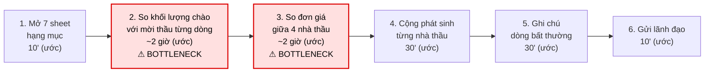
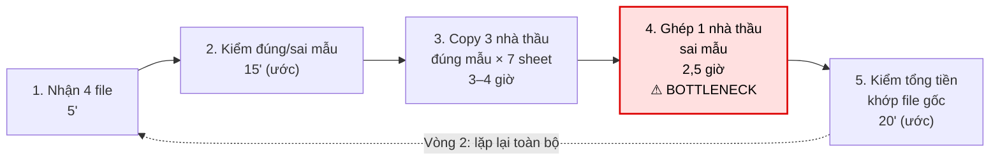
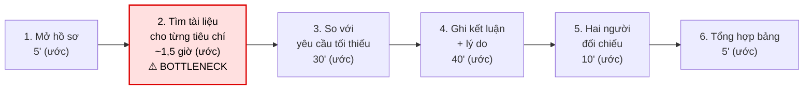

# Báo cáo cá nhân — 2A202603672_NguyenVanVinh

> Đổi tên file theo quy tắc `MSSV_HoTen.md`, ví dụ `20241234_NguyenVanAn.md` (MSSV trước, dấu `_`, họ tên viết liền không dấu). Sửa cả dòng tiêu đề phía trên cho khớp.
> Template chi tiết và prompt mẫu cho từng mục: [docs/01-worksheet.md](../../docs/01-worksheet.md).
> Mỗi thành viên một file trong `report/individual/` trên repo nhóm: copy template này thành file mới, điền, rồi commit bằng tài khoản GitHub của bạn. Không viết hộ người khác.

## 1. Thông tin học viên

- Họ tên: Nguyễn Văn Vinh
- MSSV: 2A202603672
- Email trường (không bắt buộc, repo có thể để public):
- Tên nhóm: TEAMLAGI
- Link repo nhóm: https://github.com/trongjhuongwr/K5-L3A-DAY02-TEAMLAGI-DiscoveryProblemFraming.git

**Nhân vật:** Nam, chuyên viên phòng Kinh tế – Kỹ thuật (KTKT) ở phía chủ đầu tư của một dự án tòa nhà hỗn hợp. Nam phụ trách đánh giá hồ sơ chào giá cho gói thầu cơ điện (ME). Trong công việc, Nam làm việc với 3 bên:
- Nhà thầu: nhận Hồ sơ yêu cầu (HSYC), gửi hồ sơ năng lực và bảng chào giá theo mẫu.
- Đồng nghiệp cùng tổ: chia nhau chấm năng lực và kỹ thuật.
- Lãnh đạo / ban đánh giá: duyệt bảng tổng hợp, quyết định chọn nhà thầu hoặc mời chào giá lần 2.
Một gói thầu đi qua tay Nam như sau:
1. Phát hành HSYC kèm theo:
- BOQ khoảng 4.100 dòng khối lượng.
- Danh mục thương hiệu cho các loại vật tư.
- Bộ tiêu chí đạt / không đạt.
2. Nhận hồ sơ của nhiều nhà thầu khác nhau (A, B, C, D).
3. Đánh giá năng lực và kỹ thuật: mỗi tiêu chí ghi đạt / không đạt kèm lý do.
4. Gom 4 bảng chào giá vào một file tổng hợp.
5. Soát khối lượng, đơn giá, phần phát sinh và thương hiệu.
6. Trình lãnh đạo. Nếu chưa chốt được, mời chào giá lần 2 và làm lại bước 4–6.

---

## 2. Scan problem (CP1)

Lăng kính: **Lặp lại** · **Tốn thời gian** · **Cần đọc, tổng hợp nhiều thông tin** · **Pain từ người khác**.

| # | Lăng kính | Job Story | Ai chịu ảnh hưởng? | Dấu hiệu thật |
|---:|---|---|---|---|
| 1 | Lặp lại | Khi nhận đủ bảng chào giá của các nhà thầu, tôi muốn có ngay một bảng so sánh chung, để không phải copy từng sheet của từng nhà thầu vào file tổng hợp | Nam | Tự đếm tuần gần nhất 4 nhà thầu × 7 hạng mục; file tổng hợp 63 cột/sheet. Thời gian gom 3 nhà thầu đúng mẫu đo được khoảng 3–4 giờ/vòng (chưa tính nhà thầu sai mẫu, xem #4); cả vòng khoảng 6–7 giờ |
| 2 | Lặp lại | Khi nhà thầu gửi bản chào giá sửa đổi (lần 2), tôi muốn chỉ cập nhật phần thay đổi, để không phải dựng lại bảng tổng hợp từ đầu | Nam, lãnh đạo | Gói gần nhất đếm được có bản V2 và "khối lượng mời thầu lần 2"; file tổng hợp ghi ngày 10/12 nhưng còn sửa đến 12/12. Số vòng/gói đo được là 2 vòng; vòng 2 phải gom lại từ đầu, thêm khoảng 6–7 giờ (xem #1) |
| 3 | Tốn thời gian | Khi soát bảng chào giá, tôi muốn thấy ngay dòng nào có khối lượng khác khối lượng mời thầu hoặc đơn giá bất thường, để không phải dò từng dòng | Nam | Đếm được trên tài liệu gần nhất khoảng 4.100 dòng × 4 nhà thầu ≈ 16.000 dòng; 1 nhà thầu có giá trị tính theo khối lượng chào thấp hơn giá trị tính theo khối lượng mời thầu khoảng 3 tỷ. Thời gian soát khoảng 5–6 giờ/vòng (chưa tính kiểm thương hiệu, xem #6) |
| 4 | Tốn thời gian | Khi một nhà thầu không chào theo mẫu, tôi muốn ghép được bảng của họ vào đúng hạng mục, để so sánh được với các nhà thầu khác | Nam | Gần nhất đếm được 3/4 nhà thầu theo đúng mẫu 7 sheet; 1 nhà thầu gộp vào 1 sheet 4.870 dòng. Thời gian ghép khoảng 2.5 giờ |
| 5 | Cần đọc, tổng hợp nhiều thông tin | Khi chấm năng lực, tôi muốn đối chiếu nhanh hồ sơ của từng nhà thầu với từng tiêu chí, để ghi đạt / không đạt có lý do rõ | Nam, đồng nghiệp | Gần nhất đếm được khoảng 25 tiêu chí × 4 nhà thầu ≈ 100 ô đánh giá, mỗi ô có ghi chú; 2 người cùng chấm. Mất khoảng 3 giờ công/nhà thầu (tổng của 2 người) |
| 6 | Cần đọc, tổng hợp nhiều thông tin | Khi kiểm vật tư nhà thầu chào, tôi muốn biết dòng nào dùng thương hiệu ngoài danh mục cho phép, để đánh giá đúng phần phạm vi cung cấp | Nam | Lần gần nhất đếm được 36 loại vật tư × 3 hãng cho phép; 4/4 nhà thầu bị "không đạt" ở tiêu chí thương hiệu / xuất xứ. Thời gian kiểm khoảng 3 giờ |
| 7 | Pain từ người khác | Khi lãnh đạo duyệt bảng tổng hợp, họ muốn so được giá các nhà thầu trên cùng một khối lượng, để chọn đúng nhà thầu rẻ nhất mà không bị lệch do phát sinh | Lãnh đạo, Nam | Tài liệu gần nhất bảng có 2 cột "theo khối lượng mời thầu" và "nhà thầu chào"; phát sinh mỗi nhà thầu từ 0 đến khoảng 3,9 tỷ. Số lần bị hỏi lại / trả lại khoảng 4 lần trong gói gần nhất |
| 8 | Pain từ người khác | Khi nhà thầu lập hồ sơ, họ muốn biết rõ phải nộp gì và điền theo mẫu nào, để không bị đánh "không đạt" vì thiếu giấy tờ | Nhà thầu, Nam | Nhiều ô "không đạt" do "chưa có văn bản cam kết bảo hành" hoặc "chưa có thương hiệu"; 1 nhà thầu sai mẫu. Số lần Nam phải yêu cầu bổ sung là khoảng 3 lần trong gói gần nhất |

---

## 3. Top 3 Problem Cards + quy trình nháp (CP2)

### Bảng chọn top 3

| Rank | Problem | Vì sao chọn | Điều còn chưa chắc |
|---:|---|---|---|
| 1 | Soát khối lượng và đơn giá bất thường (#3) | Khối lượng lớn nhất trong quy trình: khoảng 16.000 dòng mỗi vòng. Sót một dòng có thể làm lệch hàng tỷ đồng khi so sánh nhà thầu. Lặp lại ở mọi gói, mọi vòng nên dễ đo baseline | "Bất thường" do ai định nghĩa: lệch bao nhiêu % so với giá trung bình, hay so với dự toán? Nếu chỉ cần so khối lượng, có thể công thức Excel (No AI / Rule) là đủ |
| 2 | Gom bảng chào giá vào file tổng hợp (#1, gộp với #2 và #4) | Việc copy lặp lại ở mỗi vòng, và nặng thêm khi có nhà thầu chào sai mẫu. Đây là bước chặn trước bước soát (#3) | Bao nhiêu % nhà thầu chào sai mẫu trong các gói khác? Nếu hầu hết đúng mẫu thì một macro là đủ, không cần AI |
| 3 | Đánh giá năng lực theo tiêu chí (#5) | Phải đọc nhiều hồ sơ (chứng chỉ, hợp đồng, nhân sự) rồi viết lý do cho khoảng 100 ô. Có 2 người cùng chấm nên dễ lệch cách chấm | Hồ sơ năng lực của nhà thầu là bản scan hay file số? Phần nào cần người phán đoán (ví dụ "tạm chấp nhận"), phần nào kiểm cơ học được? |

### Problem Card #1 — Soát khối lượng và đơn giá bất thường

| Trường | Nội dung |
|---|---|
| Job Story | Khi soát bảng chào giá, tôi muốn thấy ngay dòng nào có khối lượng khác khối lượng mời thầu hoặc đơn giá bất thường, để không phải dò từng dòng |
| Actor | Nam, chuyên viên KTKT phía chủ đầu tư, phụ trách đánh giá chào giá gói cơ điện |
| Thời điểm / bối cảnh | Sau khi đã gom đủ bảng chào giá của 4 nhà thầu vào file tổng hợp, trước khi trình lãnh đạo; lặp lại ở mỗi vòng chào giá (gói gần nhất: 2 vòng). Card này giả định bảng đã được gom đúng theo mã dòng (xem Card #2) |
| Quy trình hiện tại (3–7 bước) | 1. Mở file tổng hợp, đi lần lượt 7 sheet hạng mục · 2. So khối lượng nhà thầu chào với khối lượng mời thầu từng dòng · 3. So đơn giá cùng dòng giữa 4 nhà thầu, đánh dấu chỗ chênh lớn · 4. Cộng phần phát sinh của từng nhà thầu · 5. Ghi chú dòng bất thường · 6. Gửi lãnh đạo |
| Bottleneck (bước nào, mất bao nhiêu phút) | Bước 2–3: dò khoảng 4.100 dòng × 4 nhà thầu ≈ 16.000 dòng bằng mắt; toàn bộ việc soát mất 5–6 giờ/vòng (đo gói gần nhất) |
| Impact (nếu không giải thì sao) | 10–12 giờ/gói (2 vòng); nếu sót dòng chênh thì so sánh giá bị lệch, mức lệch có thể tới hàng tỷ (gói gần nhất: 1 nhà thầu có giá trị tính theo khối lượng chào thấp hơn giá trị tính theo khối lượng mời thầu khoảng 3 tỷ); lãnh đạo hỏi lại / trả lại khoảng 4 lần |
| Success metric (baseline → target) | Thời gian soát từ 5–6 giờ/vòng xuống dưới 1,5 giờ/vòng; không sót dòng chênh khối lượng nào (baseline chưa đo: soát lại 1 gói cũ đã biết kết quả để đếm số dòng đang bị sót); số lần lãnh đạo hỏi lại không tăng |
| Phương án không dùng AI | Giữ file tổng hợp hiện có, thêm cột công thức cho từng dòng: (a) chênh khối lượng = khối lượng nhà thầu chào − khối lượng mời thầu; (b) % chênh đơn giá so với trung vị đơn giá của 4 nhà thầu cùng dòng. Tô màu tự động (conditional formatting) dòng có chênh khối lượng khác 0 hoặc chênh đơn giá vượt ngưỡng (ngưỡng cần thống nhất với lãnh đạo) |
| Giả thuyết về AI (nếu có) | Không cần AI ở bước này: khi bảng đã gom đúng theo mã dòng, công thức so sánh được mọi dòng (Rule). Trường hợp mô tả hạng mục của nhà thầu khác chữ với mô tả mời thầu phát sinh ở bước ghép file sai mẫu, nên được xét ở Card #2 |
| Cảm nhận nhanh | Rule |

Quy trình nháp hiện tại:

**HIỆN TẠI** — 6 bước, 6/6 bước thủ công. Tổng đo được: 5–6 giờ/vòng × 2 vòng/gói. Ô viền đỏ là BOTTLENECK (bước 2–3: dò từng dòng bằng mắt).

### Problem Card #2 — Gom bảng chào giá vào file tổng hợp (gộp #1, #2, #4)

| Trường | Nội dung |
|---|---|
| Job Story | Khi nhận đủ bảng chào giá của các nhà thầu, tôi muốn có ngay một bảng so sánh chung, để không phải copy từng sheet của từng nhà thầu vào file tổng hợp |
| Actor | Nam, chuyên viên KTKT phía chủ đầu tư |
| Thời điểm / bối cảnh | Ngay sau hạn nộp chào giá; lặp lại khi nhà thầu gửi bản sửa đổi (gói gần nhất: 2 vòng) |
| Quy trình hiện tại (3–7 bước) | 1. Nhận 4 file chào giá · 2. Kiểm file nào đúng mẫu 7 sheet · 3. Copy từng sheet của nhà thầu đúng mẫu vào file tổng hợp (63 cột/sheet) · 4. Ghép thủ công file sai mẫu vào đúng hạng mục · 5. Kiểm tổng tiền trong file tổng hợp khớp file gốc · 6. Vòng 2: lặp lại bước 1–5 |
| Bottleneck (bước nào, mất bao nhiêu phút) | Bước 4: ghép 1 nhà thầu sai mẫu (1 sheet 4.870 dòng) mất khoảng 2,5 giờ cho một nhà thầu, trong khi mỗi nhà thầu đúng mẫu chỉ mất khoảng 1–1,3 giờ (3–4 giờ cho 3 nhà thầu). Tính theo từng nhà thầu, bước 4 chậm gấp khoảng 2 lần |
| Impact (nếu không giải thì sao) | Khoảng 6–7 giờ/vòng, 12–14 giờ/gói; dựng lại từ đầu mỗi vòng; chặn bước soát (Card #1) |
| Success metric (baseline → target) | Thời gian gom từ khoảng 6–7 giờ/vòng xuống dưới 1 giờ/vòng; tổng tiền từng nhà thầu trong file tổng hợp khớp 100% file gốc |
| Phương án không dùng AI | Khóa mẫu chào giá (khóa cột, data validation, mã dòng cố định) và yêu cầu nộp lại nếu sai mẫu; dùng Power Query hoặc macro gom theo mã dòng |
| Giả thuyết về AI (nếu có) | AI chỉ dùng cho file sai mẫu: đọc file, gợi ý dòng nào thuộc hạng mục nào, kể cả các dòng có mô tả hạng mục khác chữ với mô tả mời thầu; Nam kiểm tổng tiền trước khi dùng |
| Cảm nhận nhanh | Rule cho file đúng mẫu; Workflow cho file sai mẫu |

Quy trình nháp hiện tại:

**HIỆN TẠI** — 5 bước/vòng, khoảng 6–7 giờ/vòng, 5/5 bước thủ công; gói gần nhất 2 vòng. Ô viền đỏ là BOTTLENECK (tính trên mỗi nhà thầu).

### Problem Card #3 — Đánh giá năng lực theo tiêu chí

| Trường | Nội dung |
|---|---|
| Job Story | Khi chấm năng lực, tôi muốn đối chiếu nhanh hồ sơ của từng nhà thầu với từng tiêu chí, để ghi đạt / không đạt có lý do rõ |
| Actor | Nam và 1 đồng nghiệp cùng tổ chấm năng lực |
| Thời điểm / bối cảnh | Sau hạn nộp hồ sơ, trước vòng so sánh giá |
| Quy trình hiện tại (3–7 bước) | 1. Mở hồ sơ năng lực của nhà thầu · 2. Với từng tiêu chí, tìm tài liệu chứng minh (chứng chỉ, hợp đồng tương tự, nhân sự, báo cáo tài chính) · 3. So với yêu cầu tối thiểu · 4. Ghi đạt / không đạt / tạm chấp nhận kèm lý do · 5. Hai người đối chiếu kết quả · 6. Tổng hợp bảng năng lực |
| Bottleneck (bước nào, mất bao nhiêu phút) | Bước 2: tìm đúng tài liệu cho từng tiêu chí; cả quy trình mất khoảng 3 giờ công/nhà thầu (tổng của 2 người) |
| Impact (nếu không giải thì sao) | Khoảng 25 tiêu chí × 4 nhà thầu ≈ 100 ô; khoảng 12 giờ công/gói (tổng của 2 người); 2 người chấm có thể lệch cách hiểu tiêu chí (giả định, chưa đo, kiểm ở CP4); thiếu giấy tờ phải yêu cầu bổ sung khoảng 3 lần |
| Success metric (baseline → target) | Tổng giờ công của 2 người từ 3 giờ xuống dưới 1,5 giờ/nhà thầu |
| Phương án không dùng AI | Checklist chuẩn cho từng tiêu chí; yêu cầu nhà thầu nộp hồ sơ theo mục lục đánh số trùng với số tiêu chí |
| Giả thuyết về AI (nếu có) | AI trích thông tin (số năm kinh nghiệm, số hợp đồng, nhân sự, chứng chỉ) kèm vị trí trang trong hồ sơ; Nam xem lại và tự kết luận |
| Cảm nhận nhanh | Workflow |

Quy trình nháp hiện tại:

**HIỆN TẠI** — 6 bước, khoảng 3 giờ công/nhà thầu (tổng của 2 người) × 4 = khoảng 12 giờ công/gói. Ô viền đỏ là BOTTLENECK.

### Card muốn pitch nhất

- Card số: 1
- Vì sao: Khối lượng lớn nhất (khoảng 16.000 dòng/vòng), có baseline đo được (5–6 giờ/vòng), hậu quả rõ (lệch so sánh giá hàng tỷ đồng, lãnh đạo hỏi lại khoảng 4 lần)
- Câu hỏi muốn nhóm phản biện: Việc này có thật sự cần AI, hay công thức Excel và tô màu là đủ?

### AI đã phản biện card thế nào

| Điểm yếu AI chỉ ra | Đồng ý? | Đã sửa gì |
|---|---|---|
| Card #1: thời gian từng bước con chỉ là ước lượng, chỉ có tổng 5–6 giờ là đo thật | Đồng ý | Đánh dấu "(ước)" cho thời gian từng bước trong sơ đồ, chỉ dùng tổng 5–6 giờ/vòng làm baseline; đưa việc bấm giờ tách bước vào danh sách cần kiểm chứng ở CP4 |
| Card #1: phần lớn việc soát có thể làm bằng công thức Excel, chưa chứng minh được vì sao cần AI | Đồng ý | Đổi "Cảm nhận nhanh" của Card #1 từ "Rule (Workflow nếu nhiều dòng lệch mô tả)" thành "Rule"; chuyển giả thuyết AI cho các dòng có mô tả khác chữ sang Card #2, vì trường hợp này phát sinh ở bước ghép file sai mẫu; ghi vào câu hỏi pitch để nhóm kiểm ở CP4 |
| Card #2: baseline chỉ từ 1 gói và 1 người, chưa biết các gói khác có hay gặp nhà thầu sai mẫu không | Đồng ý một phần | Pain gom vẫn còn khi mọi nhà thầu đúng mẫu (3–4 giờ/vòng × 2 vòng/gói), nhưng khi đó bottleneck chuyển sang bước 3 (copy) và macro / Power Query (Rule) là đủ. Đưa "tỷ lệ nhà thầu sai mẫu ở các gói khác" vào danh sách giả định cần kiểm ở CP4 |
| Card #3: chưa đo được 2 người chấm lệch nhau bao nhiêu ô, nên metric thứ hai chưa có baseline | Đồng ý | Bỏ metric "số ô 2 người chấm lệch nhau" khỏi Success metric, chỉ giữ "3 giờ → dưới 1,5 giờ/nhà thầu"; chuyển "2 người chấm lệch nhau nhiều" thành giả định cần kiểm ở CP4 |

---

## 4. Tôi đã tham gia phần nào (CP3 → CP7)

| Hoạt động | Tôi đã làm gì? | Kết quả / ảnh hưởng tới bài nhóm |
|---|---|---|
| Pitch Problem Card | Pitch 3 card V1 (soát chênh lệch), V2 (gom bảng), V3 (chấm năng lực) | V1 vào shortlist và được chọn |
| Phản biện bài của bạn khác | Hỏi Hưởng (H1): "Mất công ở nhận diện nội dung hay chờ app tải, tìm kiếm sẵn có giải được đến đâu?"; hỏi Linh (L2): "Video có transcript tốt thì tìm từ khóa có đủ không?"; hỏi Quân (Q3): "Trường nào kiểm được bằng quy tắc cố định?" | Cả 3 hướng không vào shortlist (V1, L1, T1) |
| Nhận phản biện | Review nhóm: "Tổng tiền khớp vẫn có thể che sai mapping; không lấy thời gian gom làm baseline của bước soát" | Bước duyệt kiểm mọi dòng AI ghép, không chỉ dòng tin cậy thấp; tách baseline soát (300–360 phút/vòng) khỏi gom |
| Chọn candidate problem | Cung cấp số liệu cho V1: ~4.100 dòng × 4 nhà thầu, 5–6 giờ/vòng | V1 được 30/35 điểm, cao nhất shortlist; V2 giữ làm điều kiện đầu vào |
| Kiểm chứng / research | Cung cấp số liệu domain cho CP4; tự research Power Query, Archdesk, Corten | Power Query chỉ gom được file cùng mẫu, khớp với việc tách V2 |
| Quy trình nhóm | Vẽ quy trình hiện tại và tương lai (mục 4 báo cáo nhóm) | Bản CP5 ban đầu tại PR #4 mô tả toàn luồng gom + soát. Bản tổng hợp hiện tại chọn Rule cho riêng soát; AI mapping nằm ngoài phạm vi chính |
| Problem Statement | Cung cấp baseline, bottleneck, boundary làm nguồn cho v0/v1 | Target v1: dưới 90 phút công/vòng cho phần soát, gồm kiểm/sửa/ngoại lệ |
| Mức can thiệp AI | Card #1 đã tự kết luận Rule từ CP2 | Nhóm chọn Rule; AI mapping tách thành hướng mở rộng |
| Quyết định | Được giao xác nhận phạm vi, nhật ký thời gian và quyền dùng dữ liệu | Nhóm đề xuất Not Yet, chờ kiểm các điều kiện này |

---

## 5. Dùng AI

| Checkpoint | Tôi dùng AI để làm gì? | AI hữu ích ở đâu? | AI sai hoặc hời hợt ở đâu? | Tôi sửa gì bằng nhận định của mình? |
|---|---|---|---|---|
| CP2 Problem Card | Đóng vai PM hoài nghi; rà số liệu | Chỉ ra Card #1 dùng Excel là đủ; bắt số liệu lệch | Bỏ qua việc gom vẫn mất 3–4 giờ dù đúng mẫu | Card #1 đổi sang Rule; Card #2 chỉ đồng ý một phần |
| CP4 Research | Tìm công cụ so sánh chào giá | Gợi ý Power Query, Archdesk, Corten | Đưa 1 link chết (procore.com/bidding); nguồn đều là quảng cáo nước ngoài | Tự mở từng link; Power Query chỉ gom được file cùng mẫu |
| CP5 Quy trình | Viết nháp quy trình trước/sau | Tách rõ Rule / AI / người | Tự đặt thời gian tương lai cho khớp target | Ghi rõ là ước; kiểm tỷ lệ sai mẫu ở CP4 |

---

## 6. Reflection (CP7)

Trả lời bằng trải nghiệm thật của bạn, tối thiểu 200 từ cho các câu 6.1–6.6 (không tính 6.7, câu này được chấm riêng ở tiêu chí C5). **Không dùng AI để viết thay.**

**6.1. Tôi học được gì khi nghe top 3 problems của các bạn khác?**

Khi tôi nghe top 3 problems của các bạn khác như: Hưởng, Linh, Khương, Tuyên, tôi nhận ra một problem nan giải không chỉ ở việc nó gây mất thời gian và khó khăn cho các công đoạn hay là thời gian công sức mà còn xoay quanh 3 ý chính đó là: Nó mang lại giá trị gì? Khi so sánh với thị trường nó có điểm gì vượt trội hơn và bên cạnh đó người đưa ra còn phải biết đánh giá rủi ro khi thực hiện đồng thời có 1 kế hoạch phát triển cụ thể chi tiết cho vấn đề mình muốn giải quyết. Đầu tiên về phần của Hưởng, bạn nhận thấy việc đi du lịch 1 người cần phải chuẩn bị rất nhiều bước lên lịch trình, tìm chổ ăn, ở và nhiều thứ khác quá trình này mất rất nhiều thời gian do vậy bạn đã đưa ra giải pháp tạo ra 1 ai agent tổng hợp các địa điểm nhưng bạn lại quên mất là việc này khó kiếm được nguồn đánh giá chân thực và dữ liệu về các địa điểm tốt, còn về Linh định làm phân tích khách hàng qua giọng nói nhưng bạn quên mất việc độ chính xác khi chuyển từ voice qua text còn hạn chế rất nhiều đặc biệt nếu người dùng nói giọng địa phương. Và từ đó tôi nhận ra để giải quyết 1 problem cần phải nhìn từ nhiều góc nhìn để hiểu rõ và có 1 kế hoạch giải pháp chi tiết rõ ràng rành mạch.

**6.2. Nhóm có lúc nào bị "solution-first" (nghĩ giải pháp trước khi hiểu vấn đề) không? Lúc đó nhóm nhận ra và xử lý thế nào?**

Có. Trong trao đổi ban đầu, tôi từng đề xuất ưu tiên những vấn đề có khả năng ứng dụng AI rõ ràng. Nhìn lại, cách tiếp cận này khiến nhóm có nguy cơ chọn công nghệ trước khi hiểu rõ vấn đề và có đủ bằng chứng.

Khi rà soát bài toán nhà thầu, nhóm nhận ra cần làm rõ: các dòng dữ liệu đầu vào đã được ghép đúng mã và đơn vị hay chưa? Nếu đã ghép đúng, việc so sánh số liệu có thể xử lý bằng quy tắc (Rule), chưa nhất thiết cần AI. Còn việc ghép các mô tả khác nhau nhưng cùng ý nghĩa cần được xem xét như một bài toán riêng. Vì vậy, tôi đề xuất nhóm thử phương án không dùng AI hoặc chỉ dùng Rule làm mốc đối chứng, rồi mới đánh giá AI có thực sự mang lại giá trị hơn hay không.

**6.3. Tôi có đổi ý sau khi bị phản biện không? Kể một lần cụ thể.**

Tôi chưa thay đổi hoàn toàn quan điểm, nhưng có điều chỉnh cách tiếp cận sau khi được phản biện. Cụ thể, khi xem xét bài toán so sánh báo giá nhà thầu, ý kiến cho rằng Excel đã đủ khiến tôi nhìn lại sự cần thiết của AI. Tôi nhận ra cần tách việc so sánh số liệu đã ghép đúng khỏi việc ghép các mô tả khác nhau. Vì vậy, tôi đề xuất dùng Rule làm phương án đối chứng trước. Tôi vẫn thấy AI có tiềm năng, nhưng cần chứng minh giá trị của nó trong từng phần việc cụ thể.

**6.4. Kết quả kiểm chứng (phỏng vấn/survey/research) có làm tôi bất ngờ không? Điều gì?**

Điều khiến tôi bất ngờ khi rà soát bài toán là phần so sánh số liệu có thể không cần AI nếu dữ liệu đầu vào đã được ghép đúng mã và đơn vị. Trước đó, tôi chú ý nhiều đến khả năng ứng dụng AI mà chưa xem xét kỹ điều kiện này. Nhận ra đó giúp tôi chuyển trọng tâm sang kiểm chứng xem người dùng thực sự gặp khó ở bước chuẩn hóa, ghép dữ liệu hay so sánh số liệu. Tôi chưa có đủ kết quả phỏng vấn hoặc khảo sát để khẳng định bước nào là khó khăn lớn nhất.

**6.5. Điều khó nhất khi viết Problem Statement là gì?**

Điều khó nhất với tôi là xác định đúng phạm vi vấn đề mà không đưa sẵn giải pháp vào câu mô tả. Trong bài toán nhà thầu, việc gom dữ liệu, ghép các dòng tương ứng và so sánh số liệu có liên quan với nhau, nên dễ bị gộp thành một vấn đề quá rộng. Bên cạnh đó, khi chưa đo được thời gian xử lý và số dòng bị bỏ sót hiện tại, tôi khó đặt mục tiêu cải thiện có căn cứ. Vì vậy, tôi cần làm rõ người gặp vấn đề, bước công việc gây khó khăn và tác động thực tế trước khi lựa chọn công nghệ hay đặt chỉ tiêu.

**6.6. Nếu làm lại, tôi sẽ đổi gì? Tôi sẽ phản biện nhóm mạnh hơn ở điểm nào?**

Nếu làm lại tôi sẽ cố gắng thực hiện bấm giờ đo thời gian thực hiện so sánh và chấm 1 bộ đấu thầu nhanh chóng ngay lập tức chính xác chứ không phải chỉ là "ước" tôi sẽ phỏng vấn và hỏi kỹ tình trạng các nhà thầu có thường xuyên sai mẫu không và các họ giải quyết để nhanh chóng xác định và làm chắc chắn luận điểm có nên sử dụng AI không.

**6.7. Hiểu bài:** giải thích bằng 5–8 câu, không nhìn tài liệu, chuỗi *problem → quy trình → metric → boundary → mức can thiệp AI → quyết định* của bài nhóm mình.

Chuyên viên KTKT mất nhiều công soát khối lượng và đơn giá trong bảng chào giá nhà thầu. Phạm vi đã chọn nhận bảng ghép đúng mã, đơn vị và phiên bản, kiểm đầu vào, tính chênh lệch rồi chuyển chuyên viên rà soát trước trình. Baseline riêng phần soát là 5–6 giờ/vòng theo nguồn tôi cung cấp, còn target dưới 90 phút công/vòng tính cả kiểm, sửa và ngoại lệ, không cộng công gom vào baseline soát. Kết quả phải truy về dòng nguồn, giữ số gốc và không tự chọn, loại nhà thầu hoặc gửi hồ sơ. Nhóm chọn Rule vì phép so khối lượng và độ lệch đơn giá có quy tắc kiểm được, còn AI mapping được tách thành hướng mở rộng. Quyết định hiện tại là Not Yet cho pilot, chờ quyền dữ liệu, mapping, cấu hình và bộ đáp án được xác nhận. Nếu nhận sai mapping hoặc bỏ sót chênh đã biết thì dừng dùng output để trình; sau hai vòng mà vẫn từ 90 phút/vòng trở lên hoặc không tốt hơn No AI cải tiến thì dừng mở rộng và quay về phương án đã kiểm.

---

## 7. Tài liệu tham khảo

- Worksheet và bài mẫu của lab: [docs/01-worksheet.md](../../docs/01-worksheet.md), [docs/02-deliverable-example.md](../../docs/02-deliverable-example.md)
- Intercom — Job Stories (CP1–CP2): https://www.intercom.com/blog/accidentally-invented-job-stories/
- Anthropic — Building effective agents (phân biệt Rule / Workflow / Agent): https://www.anthropic.com/research/building-effective-agents
- Microsoft — Power Query gom nhiều file từ thư mục (CP4): https://support.microsoft.com/en-us/excel/import-data-from-a-folder-with-multiple-files-power-query
- Archdesk — Subcontractor Bidding & Bid Leveling (CP4): https://archdesk.com/solutions/subcontractor-bidding
- Corten Technologies — AI Bid Leveling (CP4): https://cortentechnologies.com/ai-bid-leveling/
- Microsoft — Conditional formatting trong Excel (phương án Rule tô màu dòng chênh, Card #1): https://support.microsoft.com/en-us/excel/use-conditional-formatting-to-highlight-information-in-excel
- Microsoft — Hàm MEDIAN (% chênh đơn giá so với trung vị 4 nhà thầu): https://support.microsoft.com/en-au/excel/functions/median-function
- Teresa Torres — Opportunity Solution Trees (CP3 gom cluster, chọn opportunity): https://www.producttalk.org/opportunity-solution-trees/
- Microsoft Research — Guidelines for Human-AI Interaction (boundary, HITL, phương án quay về ở CP5): https://www.microsoft.com/en-us/research/publication/guidelines-for-human-ai-interaction/
- Marty Cagan, SVPG — The Four Big Risks (quyết định Not Yet ở CP6): https://www.svpg.com/four-big-risks/
