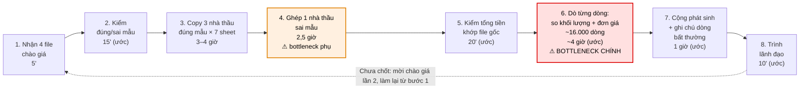
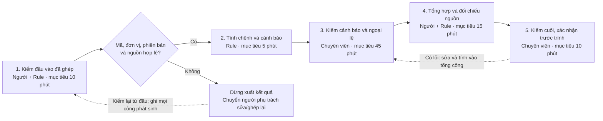

# Báo cáo nhóm — Day 02 Discovery & Problem Framing

> Bản chung của nhóm, viết trên repo do nhóm trưởng fork. Không copy file này sang repo cá nhân.
> Template chi tiết và prompt mẫu: [docs/01-worksheet.md](../../docs/01-worksheet.md). Bài mẫu: [docs/02-deliverable-example.md](../../docs/02-deliverable-example.md).

## 1. Thông tin nhóm

- Tên nhóm: TEAMLAGI
- Thành viên: 6 người, xem [TEAM.md](../../TEAM.md). Trưởng nhóm Nguyễn Trọng Hưởng xác nhận trong chat ngày 2026-11-09 rằng coach đã cho phép quy mô này và các thành viên đã đồng ý phân công.
- Candidate problem được chọn (1 câu): Đối chiếu hồ sơ chào giá của các nhà thầu với yêu cầu/BOQ và giữa các nhà thầu để phát hiện chênh lệch.
- Quyết định hiện tại: **Not Yet cho triển khai/pilot; chọn Rule cho phạm vi soát số liệu.** Quyết định điều phối được ghi ngày 2026-11-09 theo ủy quyền trực tiếp của trưởng nhóm Nguyễn Trọng Hưởng trong chat; không phải biên bản biểu quyết của sáu thành viên.
- Phạm vi đã chọn: chuyên viên KTKT soát khối lượng và đơn giá trên bảng chào giá đã ghép đúng mã, đơn vị và phiên bản BOQ. Đầu ra là danh sách chênh lệch/ngoại lệ có nguồn và xác nhận của chuyên viên. Không gồm ghép file sai mẫu, đọc PDF/scan, đánh giá năng lực hoặc chọn/loại nhà thầu. Actor và baseline tham chiếu theo Vinh; quyền sử dụng và kiểm chứng CP4 được kiểm riêng.

**Nguồn bản tổng hợp:** nội dung review CP5–CP6 được tổng hợp từ nhánh Vinh/Tuyên và ghi rõ đề xuất, baseline theo nguồn, giả định và target. CP3 dùng ghi chép trao đổi thực tế; CP4 dùng bằng chứng người ngoài nhóm. Theo dõi bàn giao tại [nhật ký điều phối](../../docs/TEAM_WORK_LOG.md).

---

## 2. Hội tụ nhóm (CP3)

Tôi tổng hợp ba card của mỗi thành viên thành 18 candidate, gom theo pain và đối chiếu ba hướng shortlist để làm rõ cơ sở chọn bài toán nhà thầu. Nguồn là sáu báo cáo cá nhân tại commit `b2bf713`; mỗi mã dưới đây gắn với đúng card trong báo cáo người đưa ra.

Hướng nhà thầu là lựa chọn nhóm đã xác nhận. Ba câu hỏi của Vinh cho H1, L2 và Q3 được dẫn theo nhật ký cá nhân Vinh; các câu hỏi còn lại là phân công trao đổi đề xuất. Điểm ở mục 2.4 là đánh giá review theo tài liệu, không phải điểm biểu quyết của sáu người. Các mốc thời gian giữ đúng loại nguồn: trí nhớ, ghi nhận trong báo cáo, giả định hoặc benchmark.

### 2.1. Pitch

| # | Người đưa ra | Candidate (Job Story ngắn) | Actor | Bottleneck | Câu hỏi phản biện nhận được (ai hỏi) |
|---:|---|---|---|---|---|
| 1 | [Hưởng](../individual/202603607_NguyenTrongHuong.md), Card #1 | **H1:** Khi cần dùng lại nội dung từng gửi trong nhóm chat, tôi muốn tìm đúng đoạn chat, ảnh, link hoặc tài liệu, để lấy được thông tin cần dùng. | Người tham gia nhóm chat, có quyền xem nội dung | Lướt, chờ tải và nhận diện nội dung; tổng lượt thành công 5–15 phút theo trí nhớ, không phải thời gian riêng bước nghẽn | **Vinh — nhật ký cá nhân:** “Mất công ở nhận diện nội dung hay chờ app tải, tìm kiếm sẵn có giải được đến đâu?” ([nguồn](https://github.com/trongjhuongwr/K5-L3A-DAY02-TEAMLAGI-DiscoveryProblemFraming/blob/067093fd0206a3c25d54224b638831bff3d7a73d/report/individual/2A202603672_NguyenVanVinh.md), mục 4). |
| 2 | [Hưởng](../individual/202603607_NguyenTrongHuong.md), Card #2 | **H2:** Khi chọn laptop trong ngân sách, tôi muốn đối chiếu cấu hình, giá, còn hàng và review, để chọn được máy phù hợp. | Người tự tìm hiểu và mua laptop | Đọc rồi đối chiếu nhiều nguồn; khoảng một tuần là thời gian lịch của lần chọn máy, không phải tổng giờ thao tác | **Đề xuất Khương trao đổi:** Thống nhất tiêu chí và bảng so sánh trước có giảm được công đối chiếu không, và thông tin nào cần kiểm lại sát thời điểm mua? |
| 3 | [Hưởng](../individual/202603607_NguyenTrongHuong.md), Card #3 | **H3:** Khi phụ trách nơi ở cho chuyến đi nhóm, tôi muốn đối chiếu chỗ ở với các hoạt động xung quanh, để phối hợp lịch trình phù hợp. | Hưởng phụ trách lưu trú; nhóm lớp hơn 10 người | Tìm chỗ ở, đọc review và phối hợp; khoảng một tuần là toàn giai đoạn chuẩn bị chuyến Vũng Tàu | **Đề xuất Tuyên trao đổi:** Bao nhiêu công thuộc riêng việc chọn nơi ở và bao nhiêu thuộc chờ các thành viên thống nhất, để metric không gộp hai nguyên nhân? |
| 4 | [Vinh](../individual/2A202603672_NguyenVanVinh.md), Card #1 | **V1:** Khi soát bảng chào giá, tôi muốn nhận ra dòng chênh khối lượng hoặc đơn giá cần xem xét, để chuẩn bị bảng đối chiếu có căn cứ trước trình duyệt. | Chuyên viên KTKT phía chủ đầu tư, phụ trách chào giá cơ điện | Dò khối lượng/đơn giá trên bảng đã ghép; khoảng 4.100 dòng × 4 nhà thầu, tổng soát 5–6 giờ/vòng theo Vinh | **Đề xuất Hưởng trao đổi:** Nếu bảng đã đúng mã và đơn vị, công thức so sánh còn bỏ trống trường hợp nào, và phần ghép sai mẫu phải được tính riêng ra sao? |
| 5 | [Vinh](../individual/2A202603672_NguyenVanVinh.md), Card #2 | **V2:** Khi nhận bảng chào giá khác cấu trúc, tôi muốn gom đúng dòng vào cùng bảng đối chiếu, để so các nhà thầu trên cùng phạm vi. | Chuyên viên KTKT tổng hợp chào giá | Một nhà thầu sai mẫu mất khoảng 2,5 giờ ghép; tổng gom 6–7 giờ/vòng theo trường hợp Vinh mô tả | **Đề xuất Quân trao đổi:** Cần bộ trường hợp nào để bắt lỗi ghép sai nhưng tổng tiền vẫn khớp, và ai xác nhận đáp án mapping? |
| 6 | [Vinh](../individual/2A202603672_NguyenVanVinh.md), Card #3 | **V3:** Khi đối chiếu hồ sơ năng lực với tiêu chí, tôi muốn tìm đúng bằng chứng cho từng tiêu chí, để ghi kết luận kèm lý do rõ. | Chuyên viên KTKT và đồng nghiệp cùng tổ | Tìm tài liệu chứng minh; khoảng 25 tiêu chí × 4 nhà thầu, 3 giờ công/nhà thầu là tổng công hai người theo nguồn | **Đề xuất Linh trao đổi:** Tiêu chí nào kiểm cơ học được, tiêu chí nào cần phán đoán chuyên môn, và bằng chứng phải dẫn tới trang/tài liệu nào? |
| 7 | [Linh](../individual/2A202603624_DamTuanLinh.md), Card #1 | **L1:** Khi kết thúc cuộc gọi CSKH, tôi muốn lưu đủ nhu cầu, vấn đề, cam kết và bước tiếp theo vào CRM, để đồng nghiệp tiếp nhận đúng ngữ cảnh. | Nhân viên CSKH/tư vấn và người tiếp nhận ca sau | Nghe lại, lọc thông tin và nhập CRM; mốc 5–8 phút/cuộc gọi trong card là giả định | **Đề xuất Hưởng trao đổi:** So với biểu mẫu bốn trường, bản nháp từ hội thoại giảm được bao nhiêu công khi tính cả nghe lại và sửa cam kết/lịch hẹn sai? |
| 8 | [Linh](../individual/2A202603624_DamTuanLinh.md), Card #2 | **L2:** Khi ôn video tiếng Anh, tôi muốn tìm đúng mốc có thuật ngữ cần học và hiểu đoạn đó, để tránh tua nhiều lần. | Sinh viên/người tự học qua video | Tua và nghe thử khi thiếu transcript; 5–15 phút/lượt trong card là giả định | **Vinh — nhật ký cá nhân:** “Video có transcript tốt thì tìm từ khóa có đủ không?” ([nguồn](https://github.com/trongjhuongwr/K5-L3A-DAY02-TEAMLAGI-DiscoveryProblemFraming/blob/067093fd0206a3c25d54224b638831bff3d7a73d/report/individual/2A202603672_NguyenVanVinh.md), mục 4). |
| 9 | [Linh](../individual/2A202603624_DamTuanLinh.md), Card #3 | **L3:** Khi chuẩn bị shortlist sau nhiều vòng tuyển dụng, tôi muốn gom bằng chứng theo cùng tiêu chí, để trưởng bộ phận rà soát mà không đọc lại mọi tài liệu rời. | HR tổng hợp; trưởng bộ phận/người phỏng vấn quyết định | Đọc, chuẩn hóa và đối chiếu CV/nhận xét; 10–20 phút/ứng viên trong card là giả định | **Đề xuất Tuyên trao đổi:** Nếu hai nhận xét mâu thuẫn hoặc một tiêu chí thiếu bằng chứng, bảng tổng hợp sẽ giữ cả nguồn và chuyển người xác minh thế nào? |
| 10 | [Khương](../individual/2A202603627_MaiDangKhuong.md), Card #1 | **K1:** Khi nhận brief và tài liệu sản phẩm, tôi muốn tổng hợp căn cứ thị trường/khách hàng, để đề xuất hướng nội dung có cơ sở. | Người làm content tại công ty truyền thông và nhận freelance | Research và tổng hợp căn cứ; khoảng hai ngày thuộc một job do người bạn chia sẻ, không phải mọi job | **Đề xuất Hưởng trao đổi:** Trong hai ngày của job đó, bước tìm nguồn, đọc hay tổng hợp tốn công nhất, và template research đã giải được phần nào? |
| 11 | [Khương](../individual/2A202603627_MaiDangKhuong.md), Card #2 | **K2:** Khi nhận user story e-commerce, tôi muốn làm rõ ràng buộc và tình huống biên, để triển khai đúng mong đợi. | Backend developer và người xác nhận nghiệp vụ | Làm rõ story khó khoảng 10 phút theo trải nghiệm; tách tự phân tích, trao đổi và chờ | **Đề xuất Linh trao đổi:** Với story khó nhưng ít phải làm lại, metric nên ưu tiên thời gian hay mức đủ của acceptance criteria, và ai chốt quy tắc nghiệp vụ? |
| 12 | [Khương](../individual/2A202603627_MaiDangKhuong.md), Card #3 | **K3:** Khi bàn giao API, tôi muốn kiểm đủ response case và mô tả rõ tham số, để frontend tích hợp với ít câu hỏi lại. | Backend viết tài liệu/kiểm thử; frontend sử dụng | Xác định case và mô tả tài liệu; gần 15 phút/API là tổng kiểm thử + tài liệu, không phải riêng một bước | **Đề xuất Quân trao đổi:** Bộ tiêu chí nào xác định tài liệu đủ và test bao phủ đúng contract, thay vì chỉ đếm số case hoặc tốc độ viết? |
| 13 | [Quân](../individual/2A202603626_PhamNgocTrungQuan.md), Card #1 | **Q1:** Khi nhận nhiều report CSKH, tôi muốn phân loại và nhận ra report cùng sự cố, để xử lý đúng nhóm vấn đề. | Nhân viên và trưởng nhóm CSKH | Đọc, phân loại và so nội dung; 3–5 giờ/lô là ghi nhận ban đầu cần đối chiếu nguồn | **Đề xuất Hưởng trao đổi:** Định nghĩa cùng sự cố khác nội dung gần giống ở đâu, và ai kiểm đáp án để bắt cả gộp nhầm lẫn bỏ sót? |
| 14 | [Quân](../individual/2A202603626_PhamNgocTrungQuan.md), Card #2 | **Q2:** Khi intern bắt đầu công việc, tôi muốn họ tìm được hướng dẫn đúng và hiểu cách làm, để giảm hướng dẫn lặp lại. | Intern, quản lý và thành viên hướng dẫn | Hướng dẫn/giải đáp; 2–3 ngày/intern là ghi nhận ban đầu, không được mặc định thành giờ công liên tục | **Đề xuất Khương trao đổi:** Câu hỏi lặp do khó tìm, tài liệu thiếu hay quy trình khó hiểu, và checklist/FAQ tập trung giải được bao nhiêu? |
| 15 | [Quân](../individual/2A202603626_PhamNgocTrungQuan.md), Card #3 | **Q3:** Khi đối soát hóa đơn/chứng từ, tôi muốn đối chiếu thông tin nhất quán, để phát hiện thiếu hoặc sai lệch trước tổng hợp. | Kế toán, tài chính và người kiểm | Đọc, nhập và đối chiếu nhiều chứng từ; mức pain trong card là giả thuyết cần khảo sát | **Vinh — nhật ký cá nhân:** “Trường nào kiểm được bằng quy tắc cố định?” ([nguồn](https://github.com/trongjhuongwr/K5-L3A-DAY02-TEAMLAGI-DiscoveryProblemFraming/blob/067093fd0206a3c25d54224b638831bff3d7a73d/report/individual/2A202603672_NguyenVanVinh.md), mục 4). |
| 16 | [Tuyên](../individual/2A202603648_GiapManhTuyen.md), Card #1 | **T1:** Khi JD thay đổi sau khi đăng nhiều kênh, tôi muốn các bản đăng được cập nhật nhất quán, để hạn chế thông tin lệch và thao tác lặp. | Recruiter, Hiring Manager và người quản lý kênh tuyển dụng | Đối chiếu/cập nhật JD giữa các kênh; benchmark viết + đăng trong báo cáo không phải baseline riêng công đồng bộ | **Đề xuất Hưởng trao đổi:** Sau một nguồn JD chung và công cụ đăng đa kênh, công cập nhật còn lại được đo thế nào để chứng minh khoảng trống cần xử lý? |
| 17 | [Tuyên](../individual/2A202603648_GiapManhTuyen.md), Card #2 | **T2:** Khi CV đến từ nhiều nguồn và định dạng, tôi muốn gom đúng thông tin và nhận ra hồ sơ thiếu/trùng, để bàn giao dữ liệu đầy đủ. | Recruiter, TA Operations và Hiring Manager | Thu thập, chuẩn hóa và kiểm trùng; số liệu ngoài trong báo cáo chỉ là benchmark tham khảo | **Đề xuất Linh trao đổi:** ATS hoặc biểu mẫu chung đã xử lý được phần nào, và tiêu chí nào xác nhận hai bản ghi là cùng một ứng viên? |
| 18 | [Tuyên](../individual/2A202603648_GiapManhTuyen.md), Card #3 | **T3:** Khi ứng viên đi qua nhiều vòng, tôi muốn biết trạng thái, việc đang chờ và người phụ trách tiếp theo, để phản hồi đúng lúc. | Recruiter, người phỏng vấn, Hiring Manager và ứng viên | Chờ feedback, cập nhật trạng thái và bàn giao; tách thời gian lịch với phút thao tác | **Đề xuất Khương trao đổi:** Chậm vì thiếu thông tin hay người phụ trách không phản hồi, và SLA/phân công rõ có giải quyết được trước khi thêm công cụ không? |

Ba câu hỏi trên được ghi theo nguồn Vinh cung cấp, không bổ sung câu trả lời hoặc tự suy rằng card bị loại vì câu hỏi đó. Các thành viên còn lại bổ sung bản ghi hỏi–đáp và thay đổi thực tế để hoàn thiện CP3; câu hỏi đề xuất không thay thế hoạt động đã diễn ra.

### 2.2. Cluster

Tôi gom theo nguyên nhân gây tốn công và công việc người dùng cần hoàn thành. Cùng cluster chỉ thể hiện pattern chung; mỗi candidate vẫn giữ actor, dữ liệu và baseline riêng.

| Cluster | Các candidate | Pattern chung |
|---|---|---|
| **A — Khó tìm đúng thông tin đã có** | H1, L2, Q2 | Nội dung tồn tại nhưng khó định vị đúng chỗ/đúng ngữ cảnh; người dùng phải lướt, nghe lại hoặc hỏi người khác. |
| **B — Khó tổng hợp nhiều nguồn thành căn cứ xử lý** | H2, H3, L1, K1, Q1 | Phải đọc, chọn và đối chiếu thông tin phân tán trước khi chọn phương án, ghi nhận nhu cầu hoặc chuyển việc. |
| **C — Khó chuẩn hóa và đối chiếu theo cùng tiêu chí** | V1, V2, V3, L3, Q3, T2 | Dữ liệu, mô tả hoặc cấu trúc khác nhau làm tăng công ghép, kiểm thiếu và xác nhận chênh lệch. |
| **D — Thông tin bàn giao thiếu rõ ràng hoặc thiếu bao phủ** | K2, K3 | Người thực hiện tiếp theo phải hỏi lại hoặc tự suy diễn vì ràng buộc, tham số và tình huống chưa được mô tả đầy đủ. |
| **E — Thay đổi và trạng thái không được cập nhật nhất quán** | T1, T3 | Nhiều bên cùng tham gia nhưng nội dung hoặc trách nhiệm thay đổi không được đồng bộ, làm tăng công kiểm và nhắc việc. |

Hai cặp cần giữ ranh giới khi hội tụ:
- **V1 và V2:** V1 so số sau khi bảng ghép đúng; V2 tạo điều kiện đầu vào đó. Không cộng toàn bộ công V2 vào baseline rồi chỉ đánh giá giải pháp tác động V1.
- **L3 và T2:** L3 tổng hợp bằng chứng theo tiêu chí để người phụ trách xem xét; T2 tập trung gom/chuẩn hóa bản ghi ứng viên. Hai phần liên quan nhưng khác đầu ra và tiêu chí đạt.

### 2.3. Opportunity Solution Tree rút gọn

Tôi đặt một outcome chung để nối các cluster, sau đó thu hẹp về một opportunity đủ cụ thể cho bài nhóm. Các nhánh mô tả nhu cầu/pain; phương án xử lý được xem sau khi xác định quy trình và bằng chứng.

```text
OUTCOME: Giảm công tìm, tổng hợp và đối chiếu thông tin cho một tác vụ cụ thể,
         đồng thời giữ chất lượng có thể kiểm tra từ nguồn
├── Opportunity A: Khó lấy đúng nội dung đã có khi cần sử dụng
│   └── H1, L2, Q2
├── Opportunity B: Thông tin phân tán làm tăng công đọc và tổng hợp căn cứ
│   └── H2, H3, L1, K1, Q1
├── Opportunity C: Dữ liệu không đồng nhất làm tăng công chuẩn hóa và đối chiếu
│   ├── V2: khó đưa chào giá về cùng hạng mục, mã dòng và đơn vị
│   ├── V1: tốn công nhận ra dòng chênh khối lượng/đơn giá sau khi đã ghép đúng
│   └── V3, L3, Q3, T2: khó tìm/ghép bằng chứng theo tiêu chí
├── Opportunity D: Bàn giao thiếu rõ ràng làm tăng công làm rõ và hỏi lại
│   └── K2, K3
└── Opportunity E: Thay đổi hoặc trạng thái không được cập nhật nhất quán
    └── T1, T3
```

**Opportunity ưu tiên:** V1 — giảm công soát chênh khối lượng/đơn giá trên bảng đã ghép đúng, bảo đảm kết quả truy về nguồn để chuyên viên kiểm. V2 được giữ như điều kiện đầu vào và một hướng mở rộng riêng. Outcome ở cấp toàn nhóm là định hướng; metric định lượng của phạm vi chọn được nêu tại mục 5 và 7.

Những ý đã gạch bỏ vì là solution đội lốt opportunity:

Các ví dụ dưới đây là cách tôi chuẩn hóa cách diễn đạt khi review, không phải lời trích từ buổi thảo luận:

- ~~“Làm agent tự chấm nhà thầu”~~ → “Chuyên viên tốn công tìm dòng chênh lệch và bằng chứng để giải trình”.
- ~~“Làm chatbot tìm mọi tài liệu”~~ → “Người dùng khó lấy đúng nội dung đã có khi cần”.
- ~~“Xây hệ thống tự động tuyển dụng đa kênh”~~ → “Thông tin JD hoặc trạng thái ứng viên không được cập nhật nhất quán giữa các bên”.

### 2.4. Chấm điểm shortlist (1–5)

Ba hướng shortlist theo thông tin nhóm đã cung cấp: **V1 — đối chiếu chào giá nhà thầu; L1 — ghi chú CSKH vào CRM; T1 — đồng bộ tuyển dụng đa kênh**. Tên L1 được thu hẹp theo card hiện tại của Linh, giữ ngoài phạm vi việc tự suy đoán khả năng trả nợ hay quyết định cho vay.

Tôi chấm đề xuất theo bảy tiêu chí, trọng số bằng nhau; tổng tối đa 35. Điểm phản ánh độ rõ và cơ sở trong tài liệu tại thời điểm review, không phải kết quả bỏ phiếu, phép đo hiệu quả hoặc so sánh quy mô thị trường. Các dữ liệu CP4/CP5 về sau không được hồi tố thành bằng chứng nhóm đã có khi pitch.

Cách đọc thang điểm:
- **Actor, quy trình:** 1 là mô tả chung; 3 là xác định được nhưng còn phần cần làm rõ; 5 là vai trò, thời điểm, đầu vào/đầu ra và bước làm rõ trong card.
- **Pain, impact:** 1 là nhận định chung; 2 là chủ yếu giả định/benchmark; 3 là có trường hợp hoặc cách đo nhưng dữ liệu hạn chế; 4 là có trường hợp và số liệu với phạm vi cụ thể; 5 đòi hỏi bằng chứng được kiểm thêm, đủ để đối chiếu cả thời gian và chất lượng.
- **Vừa sức lab, so sánh các mức:** 1 là phạm vi rộng, khó kiểm; 3 là cần chốt điều kiện truy cập/phạm vi; 5 là có phép so và đầu ra kiểm được trong phạm vi nhỏ.
- **Nhóm hiểu domain:** chấm theo căn cứ từ thành viên đưa bài, không suy một người hiểu thành cả nhóm đã thành thạo. Điểm 3 thể hiện có đầu mối kinh nghiệm; điểm cao hơn cần nhóm giải thích nhất quán quy trình và ngoại lệ.

| Candidate | Actor rõ | Quy trình rõ | Pain có bằng chứng | Impact đo được | Vừa sức lab | So sánh được No AI/Rule/Workflow/Agent | Nhóm hiểu domain | Tổng |
|---|---:|---:|---:|---:|---:|---:|---:|---:|
| **V1 — Soát chênh khối lượng/đơn giá** | 5 | 5 | 4 | 4 | 4 | 5 | 3 | **30** |
| **L1 — Ghi chú CSKH vào CRM** | 5 | 4 | 2 | 3 | 3 | 5 | 2 | **24** |
| **T1 — Đồng bộ JD trên nhiều kênh** | 4 | 4 | 2 | 3 | 3 | 5 | 3 | **24** |

**Căn cứ cho điểm đề xuất:**
- **V1:** vai trò chuyên viên KTKT và chuỗi soát đã rõ; Vinh nêu một trường hợp khoảng 4.100 dòng, bốn nhà thầu và 5–6 giờ soát/vòng. Có thể định nghĩa đối chứng bằng công thức trên cùng bảng đã ghép đúng, kiểm đến dòng nguồn. Pain/impact chưa ở mức 5 vì nguồn một trường hợp, baseline chất lượng và quyền dùng dữ liệu vẫn cần kiểm. Vừa sức ở mức 4 khi giới hạn phần soát; domain ở mức 3 vì có Vinh làm đầu mối, không mặc định cả nhóm hiểu đủ.
- **L1:** actor và thời điểm sau cuộc gọi rõ; quy trình nháp có thể vẽ được và có đối chứng biểu mẫu bốn trường. Pain ở mức 2 vì số phút trong card là giả định; impact ở mức 3 vì định nghĩa được metric nhưng chưa có baseline thực. Vừa sức/domain bị giới hạn bởi quyền xử lý cuộc gọi, chất lượng tiếng nói và hiểu quy trình CRM. Không dùng tần suất hàng nghìn cuộc gọi nêu ở scan làm số đo của một đơn vị cụ thể.
- **T1:** có quy trình cập nhật và kinh nghiệm công cụ do Tuyên mô tả; actor có nhiều bên nên cần chọn người thao tác chính. Pain ở mức 2 vì dữ liệu ngoài là benchmark, không phải baseline cập nhật JD của một tổ chức. Tần suất đổi JD, số kênh có quyền tích hợp và công còn lại sau công cụ sẵn có quyết định độ khả thi. Hai hướng L1/T1 đồng điểm nhưng khác điểm mạnh; không điều chỉnh điểm chỉ để tạo thứ hạng riêng.

**Candidate được chọn:** Đối chiếu hồ sơ chào giá của các nhà thầu với yêu cầu/BOQ và giữa các nhà thầu để phát hiện chênh lệch; lựa chọn hướng đã được trưởng nhóm xác nhận. Theo quyết định điều phối hiện tại, phạm vi chính là V1, nhận bảng đã được chuyên viên kiểm ghép đúng mã/đơn vị/phiên bản. V2 được theo dõi như phần tiền xử lý hoặc nhánh mở rộng, nằm ngoài bộ nghiệm thu V1.

**Vì sao chọn:** V1 có actor cụ thể, quy trình mô tả được, số liệu có phạm vi và cách kiểm đầu ra trực tiếp từ dòng nguồn. Bài toán cho phép so No AI cải tiến với Rule, nên có thể kiểm giá trị tăng thêm trước khi cân nhắc hỗ trợ ngữ nghĩa ở nhánh mở rộng. Điều kiện để lập luận này đứng vững là có quyền dùng dữ liệu, mapping/đơn vị đúng, đáp án đối chiếu và cách ghi công kiểm/sửa. Nếu No AI hoặc Rule đủ, đó vẫn là kết luận phù hợp với Lab.

**Vì sao loại các candidate còn lại:**
- **L1 — CSKH/CRM:** chưa ưu tiên trong vòng này vì baseline thời gian và lỗi đang là giả định; cần xác minh quyền dùng cuộc gọi và phần công còn lại sau biểu mẫu CRM. Việc dự đoán khả năng trả nợ là phạm vi khác với ghi chú sau cuộc gọi, có tiêu chí và trách nhiệm riêng; không dùng nó để làm impact cho card ghi chú.
- **T1 — Tuyển dụng đa kênh:** chưa ưu tiên trong vòng này vì benchmark viết/đăng không đo riêng việc đồng bộ JD; cần chứng minh tần suất thay đổi và khoảng trống sau một nguồn JD chung/công cụ hiện có. Phụ thuộc quyền cập nhật từng kênh khiến phạm vi thử cần thu hẹp. Lập luận này không khẳng định hướng tuyển dụng không có giá trị.

**Xử lý bất đồng (nếu có):** Tôi đề xuất quay về actor, quy trình, nguồn số liệu và phạm vi thử thay vì biểu quyết ngay theo tên giải pháp. Nếu khác nhận định về ghép và soát, tách V2 khỏi V1 và giữ metric riêng; nếu khác nhận định về mức can thiệp, lấy No AI/Rule làm đối chứng, chỉ nâng mức khi có căn cứ. Với điểm hoặc lập luận có ý kiến khác, ghi ý kiến, nguồn kiểm và điều được sửa khi review. Đoạn này mô tả cách xử lý đề xuất, không ghi nhận một cuộc tranh luận cụ thể hoặc tự kết luận nhóm không có bất đồng.

---

## 3. Kiểm chứng + research giải pháp đã có (CP4)

**Nguồn kiểm chứng:** phần 3.1–3.2 theo cập nhật Linh tại `e278c07` và `4efec2b`; số liệu domain bổ trợ theo báo cáo Vinh. Snapshot được xem trong đúng giới hạn nguồn ghi ở ghi chú review dưới đây. Mục 3.3 giữ research của Khương đã merge qua PR #5; tài liệu Microsoft bổ trợ được dẫn riêng ở mục 10.

### 3.1. Assumption Map

| # | Giả định | Loại (Value / Usability / Feasibility / Viability) | Quan trọng (1–5) | Đã có bằng chứng (1–5) | Kiểm chứng trước? |
|---:|---|---|---:|---:|---|
| 1 |Người phụ trách đánh giá thầu mất nhiều thời gian đối chiếu thủ công HSDT của nhiều nhà thầu với các tiêu chí trong HSMT|Value |5 | 2|Ưu tiên 1|
| 2 |Quá trình đối chiếu thủ công có nguy cơ bỏ sót sự khác biệt về thông số kỹ thuật, giá, tiến độ và điều kiện hợp đồng |Value |5 |2 |Ưu tiên 2 |
| 3 |Người đánh giá cần xem được vị trí tài liệu gốc làm căn cứ cho từng kết quả so sánh, thay vì chỉ nhận kết luận tự động|Usability	 |5 |2 |Ưu tiên 3 |
| 4 |Có thể trích xuất đủ chính xác thông tin từ các HSDT có định dạng PDF, Word, bảng biểu hoặc bản scan để hỗ trợ đối chiếu|Feasibility	 |5 |3 |có |
| 5 |Người dùng sẵn sàng thay đổi một phần quy trình hiện tại để sử dụng công cụ hỗ trợ so sánh, nhưng vẫn giữ quyền quyết định cuối cùng|Usability	 |4 |1 |có |
| 6 |Lợi ích tiết kiệm thời gian và giảm công sức kiểm tra đủ lớn để đơn vị cân nhắc chi phí triển khai, bảo mật và vận hành|Viability |4 |1 |có |

*Điền 4–6 giả định; xóa dòng thừa.*

Giả định nhóm kiểm chứng trong buổi này: Giả định #1 — Việc so sánh, đối chiếu HSDT thực sự tạo ra khối lượng công việc thủ công đáng kể, có thể đo được bằng thời gian xử lý và số lần phải kiểm tra lại.

Lý do: Đây là giả định cốt lõi về giá trị của vấn đề. Nếu người dùng không mất nhiều thời gian hoặc đã có công cụ đáp ứng tốt, việc phát triển giải pháp mới có thể không cần thiết.

### 3.2. Kiểm chứng

Cách ghi nhận theo Linh: phỏng vấn 3 người có kinh nghiệm đấu thầu xây dựng. Repo có một snapshot chi tiết và bảng tổng hợp; vai trò, ngày/cách hỏi và tình huống của từng người cần được bổ sung từ nguồn thực tế.

| Trường | Nội dung |
|---|---|
| Người được hỏi (vai trò) |Chuyên viên phụ trách hồ sơ đấu thầu tại công ty xây dựng|
| Câu nói đáng nhớ nhất (nguyên văn) |Có rất nhiều số liệu cần so sánh |
| Lần gần nhất gặp vấn đề này: chuyện gì đã xảy ra? | Trong quá trình đối chiếu hồ sơ, một số liệu quan trọng liên quan đến khối lượng nguyên vật liệu bị sai lệch, dẫn đến thiếu hụt vật tư so với nhu cầu thực tế.|
| Hiện đang xử lý bằng cách nào (workaround)? |Kiểm tra lại số liệu và tự bù đắp phần vật liệu thiếu hụt.|
| Mất bao lâu, bao lần? | Chưa có số liệu cụ thể về thời gian và tần suất; cần hỏi thêm để định lượng mức độ ảnh hưởng. |
| Insight / opportunity rút ra |Việc đối chiếu nhiều số liệu về khối lượng vật tư có thể tạo ra rủi ro sai sót và thiệt hại tài chính. Cơ hội là hỗ trợ phát hiện chênh lệch và truy vết số liệu trước khi hoàn tất hồ sơ|

Tổng hợp:

| Nguồn | Số người / số mẫu | Tín hiệu xác nhận | Tín hiệu phản bác |
|---|---:|---|---|
| Phỏng vấn chuyên viên đấu thầu| 3|2 người xác nhận muốn sử dụng sản phẩm làm 1 công cụ hỗ trợ làm việc | 1 người nói việc đối chiếu rất phức tạp AI detech cũng có thể sai và không ai chịu trách nhiệm cho việc đó|

**Nhóm đã sửa problem thế nào sau kiểm chứng:** Theo tổng hợp Linh cung cấp, một ý kiến lo ngại độ chính xác/trách nhiệm khiến hướng ban đầu cần giữ chuyên viên kiểm chứng thay cho tự động kết luận. Sau review quy trình, phạm vi hiện tại thu hẹp tiếp về so số bằng Rule trên bảng đã ghép đúng; AI mapping được tách riêng. Hai ý kiến muốn sử dụng là tín hiệu quan tâm, không chứng minh đã giảm thời gian hoặc đạt target.

Ghi chú review nguồn CP4: Linh đã bổ sung tổng hợp 3 người, trong đó có một ý kiến lo ngại độ chính xác và trách nhiệm; repo mới có một snapshot chi tiết. Hai ý kiến muốn sử dụng là tín hiệu quan tâm, không thay thế bằng chứng hành vi. Linh bổ sung vai trò, ngày/cách hỏi và tình huống cụ thể của từng người; thời gian/tần suất cần có nguồn trước khi dùng định lượng pain. Các giả định về trích PDF/scan thuộc hướng mở rộng, không mặc định là điều kiện của Rule so số.

### 3.3. Research giải pháp đã có

Liên kết tài liệu chính thức được mở kiểm trong lượt review PR ngày 2026-11-09. Chức năng được tài liệu mô tả không chứng minh công cụ đã đạt target trên dữ liệu nhóm; cách áp dụng và khoảng trống trong bảng được giữ như đề xuất cần kiểm.

| Công cụ / case / pattern | Link | Giải bước nào trong quy trình? | Điểm mạnh | Khoảng trống / rủi ro | Bài học cho nhóm |
|---|---|---|---|---|---|
| **Excel: công thức + Conditional Formatting (Rule)** | [Microsoft: định dạng theo điều kiện](https://support.microsoft.com/en-us/excel/use-conditional-formatting-to-highlight-information-in-excel); [hàm MEDIAN](https://support.microsoft.com/en-au/excel/functions/median-function) | Microsoft hỗ trợ tô màu theo công thức và tính trung vị. Nhóm có thể áp dụng vào bước 2–3: tính chênh khối lượng và độ lệch đơn giá so với trung vị; dùng kết quả làm danh sách cần rà soát ở bước 5. Đây là cách áp dụng do nhóm đề xuất. | Phù hợp với file tổng hợp hiện tại; phép tính minh bạch, truy lại được từng dòng; không cần LLM. | Phải kiểm mã dòng, đơn vị tính và kiểu dữ liệu; cần thống nhất ngưỡng cảnh báo. Ô trống, giá 0 và công thức lỗi cần xử lý riêng. Trung vị của 4 báo giá không đồng nghĩa với giá thị trường hợp lý. | Dùng làm baseline không AI. Đo xem công thức và bộ lọc có đủ đưa thời gian soát xuống dưới 1,5 giờ/vòng trước khi xây thêm hệ thống. |
| **Procore Bidding — Bid Leveling** | [Procore: Level Bids for a Bid Form](https://support.procore.com/products/online/user-guide/project-level/bidding/tutorials/level-bids-for-a-bid-form) | Hỗ trợ đối chiếu chào giá ở bước 2–3 và ghi nhận rà soát ở bước 5: xem dòng thiếu/loại trừ, điều chỉnh giá trị, ghi chú, tô màu và xem lịch sử thay đổi. | Tập trung việc so sánh và lưu dấu vết điều chỉnh trên cùng công cụ. | Tài liệu yêu cầu có bid form và báo giá trong hệ thống. Chưa xác minh khả năng nhận nguyên trạng file Excel 7 sheet của Nam, tự cảnh báo theo ngưỡng trung vị hoặc xử lý gói 4.100 dòng trong thời gian mục tiêu. | Học cách tách giá trị nhà thầu nộp với giá trị điều chỉnh khi so sánh; lưu lý do và lịch sử. Không xem “có bid leveling” là bằng chứng đáp ứng toàn bộ workflow của Nam. |
| **Autodesk BuildingConnected — Bid Leveling** | [BuildingConnected: Bid Leveling Overview](https://support.buildingconnected.com/hc/en-us/articles/47949854611219-Bid-Leveling-Overview) | Hỗ trợ bước 3–5: trình bày báo giá từng nhà thầu thành các cột, chia theo mục/dòng của bid form; so với estimated cost; tô màu, ghi chú và điều chỉnh giá trị khi rà soát. | So sánh trực quan trên một bảng; có mốc dự toán để tham chiếu và chỗ ghi nhận nhận xét. | Cấu trúc so sánh dựa trên bid form của dự án. Chưa xác minh việc nhập file hiện có, kiểm chênh khối lượng mời thầu tự động hoặc phát hiện đơn giá bất thường theo quy tắc nhóm cần. | Học cách trình bày báo giá cạnh nhau, phân biệt chênh so với dự toán và chênh giữa nhà thầu. Cần thử bằng dữ liệu mẫu trước khi kết luận phù hợp. |

---

## 4. Quy trình trước/sau (CP5)

Mục 4.1 giữ quy trình gom + soát do Vinh cung cấp để giải thích bối cảnh. Mục 4.2–4.3 mô tả riêng phạm vi Rule đã chọn theo quyết định điều phối ngày 2026-11-09; thời gian tương lai là mục tiêu thiết kế, không phải kết quả pilot. Kịch bản toàn luồng có AI mapping trước đây được lưu trong PR #4; không dùng target của kịch bản đó để đánh giá phạm vi hiện tại.

Phạm vi: từ lúc nhận bảng chào giá của 4 nhà thầu đến lúc trình lãnh đạo, gồm 2 phần **gom** (Card #2) và **soát** (Card #1) trong báo cáo cá nhân của Nguyễn Văn Vinh. Vẽ cả phần gom vì bước soát chỉ làm được khi bảng của 4 nhà thầu đã được gom đúng theo mã dòng. Số liệu lấy từ gói thầu gần nhất; thời gian ghi "(ước)" là ước lượng từng bước, tổng gom và tổng soát là đo thật.

### 4.1. Quy trình hiện tại

**HIỆN TẠI** — 8 bước/vòng, 8/8 bước thủ công, khoảng 11–13 giờ/vòng × 2 vòng/gói. Ô viền đỏ là bottleneck.



| Bước | Actor | Input | Output | Thời gian / tần suất | Ghi chú |
|---:|---|---|---|---|---|
| 1 | Chuyên viên KTKT (Nam) | Email / file nộp của 4 nhà thầu | 4 file Excel chào giá đã lưu | 5' / vòng | 2 vòng/gói ở gói gần nhất |
| 2 | Chuyên viên KTKT | 4 file chào giá, mẫu 7 sheet trong HSYC | Danh sách file đúng mẫu / sai mẫu (gói gần nhất: 3 đúng, 1 sai) | 15' (ước) / vòng | |
| 3 | Chuyên viên KTKT | 3 file đúng mẫu | File tổng hợp 7 sheet, 63 cột/sheet | 3–4 giờ / vòng (đo) | Copy tay từng sheet |
| 4 | Chuyên viên KTKT | 1 file sai mẫu (1 sheet 4.870 dòng) | Dòng của nhà thầu sai mẫu được xếp vào đúng hạng mục, đúng mã dòng | 2,5 giờ / vòng (đo) | Bottleneck phụ: chậm khoảng 2 lần so với một nhà thầu đúng mẫu; chỉ xảy ra khi có nhà thầu sai mẫu |
| 5 | Chuyên viên KTKT | File tổng hợp + 4 file gốc | Xác nhận tổng tiền từng nhà thầu khớp file gốc | 20' (ước) / vòng | Handoff sang phần soát |
| 6 | Chuyên viên KTKT | File tổng hợp (~4.100 dòng × 4 nhà thầu) | Các dòng có khối lượng khác mời thầu hoặc đơn giá chênh lớn được đánh dấu | ~4 giờ (ước) / vòng | **Bottleneck chính**; dò bằng mắt |
| 7 | Chuyên viên KTKT | Các dòng đã đánh dấu | Tổng phát sinh từng nhà thầu (0 đến ~3,9 tỷ) + ghi chú lý do | 1 giờ (ước) / vòng | |
| 8 | Chuyên viên KTKT → Lãnh đạo | Bảng tổng hợp có ghi chú | Lãnh đạo chọn nhà thầu, hỏi lại, hoặc mời chào giá lần 2 | 10' (ước) / vòng | Gói gần nhất: bị hỏi lại / trả lại ~4 lần |

Tổng: gom (bước 1–5) 6–7 giờ + soát (bước 6–8) 5–6 giờ = **khoảng 11–13 giờ/vòng, 22–26 giờ/gói (2 vòng)**.

**Bottleneck chính:** Bước 6, dò khoảng 16.000 dòng (4.100 dòng × 4 nhà thầu) bằng mắt để tìm dòng có khối lượng khác mời thầu hoặc đơn giá chênh lớn, mất khoảng 4 giờ/vòng. Đây là bước vừa tốn thời gian nhất vừa có rủi ro cao nhất: sót một dòng có thể làm lệch so sánh giá tới hàng tỷ (gói gần nhất có 1 nhà thầu mà giá trị tính theo khối lượng chào thấp hơn giá trị tính theo khối lượng mời thầu khoảng 3 tỷ). Bước 4 là bottleneck phụ, phụ thuộc vào việc có nhà thầu sai mẫu hay không (tỷ lệ này cần kiểm ở CP4).

### 4.2. Quy trình tương lai

**Phương án đã chọn: Rule, riêng phần soát.** Điểm bắt đầu là bảng tổng hợp đã được người phụ trách xác nhận mapping; điểm kết thúc là bảng chênh lệch đã được chuyên viên kiểm trước trình. Gom file và thời gian lãnh đạo cân nhắc lựa chọn nằm ngoài phép đo này.

Các phút dưới đây là **ngân sách thiết kế để kiểm trong pilot**, không phải số đo hoặc cam kết đã đạt. Tổng ngân sách 85 phút nằm trong target **dưới 90 phút công/vòng**; mọi công kiểm/sửa và ngoại lệ phát sinh trong lượt soát đều được cộng vào kết quả thực tế, kể cả khi vượt ngân sách.



| Bước | Actor | Input | Output | Thời gian mục tiêu / vòng | Kiểm soát |
|---:|---|---|---|---|---|
| 1 | Chuyên viên KTKT + Rule | Bảng đã gom, BOQ và file nguồn đúng phiên bản | Kết quả kiểm mã/khóa, đơn vị, kiểu số, đủ nhà thầu và liên kết nguồn | 10 phút | Không đạt thì chuyển sửa/ghép lại; giữ lượt thất bại trong nhật ký. |
| 2 | Rule | Dữ liệu qua cổng kiểm, cấu hình đã duyệt | Chênh khối lượng; độ lệch đơn giá so với trung vị; danh sách thiếu dữ liệu/ngoại lệ | 5 phút | Không coi ô trống là 0; không chia cho trung vị 0; không tự chuyển đơn vị hay giải thích nguyên nhân chênh. |
| 3 | Chuyên viên KTKT | Cảnh báo, ngoại lệ, file nguồn | Kết quả đối chiếu, lý do và yêu cầu làm rõ từng dòng | 45 phút | Cảnh báo giá chỉ là tín hiệu cần rà soát; chuyên viên xác định ý nghĩa, không suy thành sai giá hoặc gian lận. |
| 4 | Chuyên viên + Rule | Các dòng đã kiểm | Bảng tổng hợp có nguồn, chênh lệch và trạng thái ngoại lệ | 15 phút | Kiểm bao phủ dòng, mapping và tổng tiền; tổng tiền khớp không đủ chứng minh mapping đúng. |
| 5 | Chuyên viên KTKT | Bảng tổng hợp và danh sách ngoại lệ | Bản được xác nhận để trình lãnh đạo hoặc trả lại để sửa | 10 phút | Không xuất bản chưa kiểm; quyết định nhà thầu thuộc người có thẩm quyền. |

**Boundary:** giữ nguyên file gốc; không tự bỏ dòng, sửa số, ghép ngữ nghĩa, đánh giá năng lực, chọn/loại nhà thầu hoặc gửi hồ sơ. Mọi dòng phải có trạng thái và nguồn đối chiếu. Chỉ dùng dữ liệu/nơi xử lý được cho phép.

**Phương án quay về:** sai mapping/phiên bản, mất hoặc trùng dòng, lệch tổng ngoài dung sai hay lỗi công thức thì ngừng dùng output để trình và đối chiếu trên file gốc. File sai mẫu chuyển người phụ trách ghép hoặc yêu cầu nộp lại đúng mẫu; công phát sinh được ghi riêng để đánh giá chi phí đầu vào, không dùng để làm đẹp metric soát. Trong lượt soát, mọi công phát hiện và xử lý ngoại lệ vẫn tính vào target.

### 4.3. Before / after

| Chỉ số | Trước | Sau (mục tiêu, cần kiểm) | Ghi chú |
|---|---|---|---|
| Số bước trong phạm vi soát | 3 bước chính: bước 6–8 của mục 4.1 | 5 bước chính: R1–R5 của mục 4.2 | Không dùng 8 bước toàn luồng gom + soát để so trực tiếp với 5 bước riêng soát. Nhánh sửa lỗi/lặp lại được ghi công riêng trong tổng. |
| Bước có con người tham gia | 3/3 bước soát | 4/5 bước: R1, R3, R4, R5; R2 là Rule | R1/R4 kết hợp người + Rule. Số bước không phải tỷ lệ giờ công; metric thời gian vẫn tính mọi công kiểm/sửa/ngoại lệ. |
| Phạm vi | Soát trên bảng đã gom: bước 6–8 của mục 4.1 | Kiểm đầu vào → tính → kiểm cảnh báo → tổng hợp → xác nhận trước trình | Cùng dữ liệu, số nhà thầu, loại chênh lệch và điều kiện kết thúc. |
| Công soát / vòng | 300–360 phút theo Vinh | Dưới 90 phút; ngân sách thiết kế 85 phút | Baseline cần đối chiếu nhật ký; target tính cả kiểm/sửa/ngoại lệ. Báo riêng công gom, thiết lập lần đầu và thời gian chờ. |
| Bottleneck | Dò từng dòng bằng mắt, khoảng 4 giờ theo ước lượng của Vinh | Kiểm cảnh báo/ngoại lệ, ngân sách 45 phút | Phụ thuộc chất lượng đầu vào và số cảnh báo; không coi ngân sách là kết quả. |
| Chất lượng | Chưa có tỷ lệ bỏ sót/báo nhầm được đo đáng tin cậy | Đạt đồng thời năm tiêu chí mục 7 | Không suy tỷ lệ từ số dòng của gói thầu hoặc số lỗi nhớ lại. |
| Rủi ro mới | Phụ thuộc người rà soát | Sai công thức, khóa/đơn vị hoặc ngưỡng; tin vào cảnh báo và bỏ qua ngoại lệ | Kiểm nguồn/đáp án độc lập, duyệt cấu hình và giữ khả năng quay về. |


---

## 5. Problem Statement v0 (CP5)

Phạm vi của v0/v1 là **riêng phần soát** đã chọn trong mục 1 và 8. Quy trình hiện tại mục 4.1 thể hiện bối cảnh gom + soát; mục 4.2–4.3 và phép đo v0/v1 chỉ bao gồm phần soát. Công gom và xử lý file sai mẫu được báo riêng.

v0 được tổng hợp từ pain và quy trình trong báo cáo Vinh, giữ cách mô tả vấn đề trước lựa chọn công cụ. Quyết định điều phối ngày 2026-11-09 chọn phạm vi, metric và boundary dưới đây làm cơ sở chuẩn bị đánh giá; baseline, quyền dữ liệu và đáp án vẫn phải được người phụ trách kiểm.

| Trường | Nội dung |
|---|---|
| **Actor** | Chuyên viên KTKT phía chủ đầu tư phụ trách soát chào giá gói cơ điện. |
| **Quy trình** | Sau khi gom chào giá vào bảng tổng hợp, kiểm khối lượng với BOQ, so đơn giá, tổng hợp phát sinh và ghi chú trước khi trình lãnh đạo. |
| **Bottleneck** | Dò từng dòng khối lượng và đơn giá giữa khoảng 4.100 hạng mục và 4 nhà thầu; bước 2–3 khoảng 240 phút theo phân rã ước lượng của Vinh. |
| **Impact** | Riêng phần soát được Vinh báo cáo 5–6 giờ/vòng, hai vòng/gói. Dòng chênh bị bỏ sót có thể làm thông tin trình duyệt thiếu chính xác; khoản chênh trong một hồ sơ không được quy thành thiệt hại đã phát sinh. |
| **Success Metric** (baseline → target, cách đo) | Baseline tham chiếu 300–360 phút/vòng theo Vinh → target đề xuất dưới 90 phút/vòng cùng phạm vi; không bỏ sót chênh khối lượng xác định được trong bộ đối chiếu. Chạy trên một bộ hồ sơ cũ được phép dùng, chuyên viên kiểm đáp án; ghi công xử lý, kiểm/sửa, kết quả và ngoại lệ cho từng vòng. |
| **Boundary** (AI không được làm gì; khi nào cần con người kiểm tra — HITL) | Bảo toàn số gốc và nguồn; chuyên viên xác nhận trường hợp mơ hồ và bảng trước trình; không tự chọn/loại nhà thầu, sửa giá/khối lượng hoặc gửi hồ sơ. |

Phản biện nhận được (từ AI hoặc nhóm khác) và nhóm có đồng ý không:

- Review tài liệu chỉ ra v0 cần nói rõ điều kiện mapping; không lấy thời gian gom làm baseline riêng bước soát.
- Target thời gian phải tính cả công kiểm/sửa; các lượt không xử lý được phải báo kết quả, không chỉ chọn lượt thành công.
- Tổng tiền khớp vẫn có thể che sai mapping; cần kiểm nguồn và bộ tình huống đổi dòng.
- Ngưỡng và đáp án cần người domain duyệt; các điểm này được đưa vào v1 và điều kiện chuyển Go. Phản hồi của nhóm được ghi theo trao đổi thực tế.

---

## 6. Mức can thiệp AI (CP6)

### 6.1. Ma trận độ mơ hồ × độ phức tạp
**Bài toán:** Kiểm tra chênh lệch khối lượng, đơn giá và các thông tin bất thường trong hồ sơ chào giá gói thầu cơ điện

**Bối cảnh:**

Một gói thầu có khoảng 4.100 dòng BOQ, 4 nhà thầu tham gia chào giá, tương đương khoảng 16.000 dòng cần đối chiếu mỗi vòng
Theo dữ liệu từ Problem Card cá nhân, quá trình kiểm tra mất khoảng 5–6 giờ/vòng và một gói thầu có thể trải qua 2 vòng chào giá

**Đánh giá các công đoạn:**

| Công đoạn | Độ mơ hồ | Độ phức tạp | Nhận định |
|---|---|---|---|
| So khối lượng chào với BOQ | Thấp | Cao về khối lượng dữ liệu | Có thể sử dụng công thức và Rule |
| Phát hiện đơn giá chênh lệch | Trung bình | Trung bình | Rule phát hiện, con người đánh giá nguyên nhân |
| Gom file đúng mẫu | Thấp | Trung bình | Power Query, Macro |
| Ghép file sai mẫu | Cao | Cao | Workflow kết hợp AI hỗ trợ đối chiếu ngữ nghĩa |
| Đánh giá hồ sơ năng lực | Cao | Cao | AI trích xuất bằng chứng, chuyên viên quyết định |

**Vị trí của bài toán chính:** Độ mơ hồ thấp khi bảng đã ghép đúng mã/đơn vị và quy tắc rõ; nhiều nguồn/bước phụ thuộc nhau tạo độ phức tạp tích hợp. Số dòng lớn riêng nó không chứng minh cần Agent.

Khó khăn chính không nằm ở việc cần AI suy luận mà nằm ở số lượng dòng phải kiểm tra lớn, thao tác thủ công lặp lại và nguy cơ bỏ sót các chênh lệch

### 6.2. So sánh bốn mức can thiệp

| Mức | Phương án | Khả năng giải quyết | Hạn chế | Lựa chọn |
|---|---|---|---|---|
| No AI | Chuẩn hóa mẫu, checklist mã/đơn vị/phiên bản, phân công kiểm và quản lý BOQ chung; soát thủ công theo cách đã cải tiến | Có thể đủ khi phạm vi nhỏ hoặc công soát sau cải tiến đạt mục tiêu | Cần đo công còn lại sau cải tiến, không mặc định bằng hiện trạng 5–6 giờ/vòng | Đối chứng cần thử trước khi chọn Rule |
| Rule | Sử dụng Excel Formula, Conditional Formatting, Power Query để phát hiện chênh lệch | Có thể kiểm tra toàn bộ dòng đã khớp mã, tự động tính chênh khối lượng và đơn giá | Cần dữ liệu được ghép đúng, chưa tự hiểu file sai mẫu | **Ưu tiên cho bài toán chính** |
| Workflow | Kết hợp bước nhập dữ liệu, kiểm tra, tổng hợp và xuất báo cáo, bổ sung AI khi cần xử lý dữ liệu phi cấu trúc | Giảm thao tác giữa các bước, hỗ trợ xử lý nhà thầu chào sai mẫu | Phụ thuộc dữ liệu đầu vào và khả năng đối chiếu | Cân nhắc cho bài toán mở rộng |
| Agent | Hệ thống tự lựa chọn công cụ, phân tích hồ sơ và thực hiện nhiều bước | Linh hoạt với tác vụ có nhiều ngoại lệ | Chi phí cao, khó kiểm soát, nguy cơ kết luận sai | Chưa cần thiết |

**Mức đã chọn theo quyết định điều phối ngày 2026-11-09: Rule-based Automation.** Chọn hướng thiết kế không đồng nghĩa cho phép pilot khi các điều kiện dữ liệu và đáp án chưa đủ.

**Lý do:**

- Chênh lệch khối lượng có thể xác định chính xác bằng phép tính
- Chênh lệch đơn giá có thể phát hiện bằng công thức và ngưỡng cảnh báo
- Không cần sử dụng LLM để xử lý dữ liệu số đã có cấu trúc
- Dễ kiểm thử, giải thích kết quả và đối chiếu với file gốc
- Giảm chi phí và rủi ro so với phương án dùng Agent

**Trường hợp có thể sử dụng AI:**

Khi nhà thầu gửi bảng chào giá không theo mẫu, mô tả hạng mục khác cách diễn đạt trong BOQ, AI có thể đề xuất ghép các dòng tương ứng theo ý nghĩa
Đây là công đoạn thuộc Problem Card #2, không phải bước so sánh số liệu của Problem Card #1

### 6.3. AI Canvas rút gọn

Phương án Rule chính không cần AI Canvas theo worksheet. Bảng dưới là bản chuẩn bị riêng cho hướng mở rộng ghép file sai mẫu nếu sau này có bằng chứng cần AI; không tính lợi ích của hướng này vào target soát Rule.

| Thành phần | Nội dung |
|---|---|
| **Prediction** | Với file sai mẫu, AI đề xuất mã BOQ hoặc hạng mục tương ứng cho từng dòng chào giá dựa trên nội dung mô tả |
| **Judgment** | Chuyên viên KTKT kiểm tra mã dòng, quy cách, đơn vị tính, khối lượng và sự phù hợp của đề xuất |
| **Action** | Hệ thống tạo bảng đối chiếu và danh sách dòng bất thường, chuyên viên xác nhận trước khi sử dụng |
| **Outcome** | Giảm thời gian kiểm tra và ghép bảng, không bỏ sót dòng chênh khối lượng, tổng tiền khớp file gốc |
| **Input** | BOQ gốc, bảng chào giá của nhà thầu, mã hạng mục, mô tả, đơn vị tính, khối lượng và đơn giá |
| **Feedback** | Các dòng được chuyên viên chấp nhận, chỉnh sửa hoặc từ chối, kết quả soát lại trên gói thầu đã có đáp án |

**Điểm can thiệp chính:**

- Rule phát hiện chênh lệch số liệu
- AI hỗ trợ đối chiếu mô tả hạng mục không đồng nhất
- Chuyên viên KTKT kiểm tra và xác nhận kết quả
- Lãnh đạo tiếp tục chịu trách nhiệm phê duyệt theo quy trình

**Boundary:**

- Không tự động kết luận nhà thầu đạt hoặc không đạt
- Không tự động lựa chọn nhà thầu trúng thầu
- Không thay đổi file chào giá gốc
- Không tự sửa khối lượng hoặc đơn giá do nhà thầu cung cấp
- Không tự ghép các dòng thiếu căn cứ đối chiếu
- Không sử dụng dữ liệu hồ sơ ngoài phạm vi được cấp quyền
- Các trường hợp thiếu mã, trùng mã hoặc không khớp tổng tiền phải được chuyển cho chuyên viên kiểm tra
- Khi hệ thống không thể xác định kết quả đáng tin cậy, quay về quy trình kiểm tra thủ công

### 6.4. Hai câu hỏi Google PAIR

Các câu trả lời sau phục vụ hướng mở rộng có AI và cần actor xác nhận. Không coi chúng là bằng chứng nhóm đã chọn hoặc thử AI trong phạm vi Rule.

**1. Người dùng muốn được hỗ trợ hay giao hẳn việc cho hệ thống?**

Đề xuất kết hợp cả hai cách tùy theo công đoạn
Đối với việc so sánh khối lượng, đơn giá và tổng tiền theo các công thức đã xác định, có thể tự động hóa hoàn toàn bước tính toán
Đối với việc ghép file sai mẫu, nhận diện hạng mục tương đương và đánh giá nguyên nhân chênh lệch, hệ thống chỉ đưa ra gợi ý và bằng chứng để chuyên viên xác minh
Cách tiếp cận này giúp giảm thao tác lặp lại nhưng vẫn giữ trách nhiệm chuyên môn và quyết định ở con người
Đây là đề xuất thiết kế, cần được xác nhận với người trực tiếp xử lý hồ sơ

**2. AI sai kiểu nào tệ hơn, báo nhầm hay bỏ sót?**
Đối với bài toán này, bỏ sót một chênh lệch quan trọng có thể gây hậu quả lớn hơn vì ảnh hưởng đến việc so sánh giá trị chào thầu

- False Positive: Cảnh báo dòng bất thường nhưng thực tế có lý do hợp lệ, khiến chuyên viên phải kiểm tra thêm
- False Negative: Không phát hiện dòng chênh lệch thực sự, khiến thông tin bất thường không được đưa ra xem xét

Do đó, ưu tiên phát hiện đầy đủ các chênh lệch khối lượng có thể xác định bằng công thức
Đối với đơn giá, cảnh báo bất thường không đồng nghĩa với đơn giá sai, mà chỉ là tín hiệu cần người phụ trách kiểm tra

**Phương án kiểm soát:**

- Đối chiếu theo mã dòng và đơn vị tính
- Kiểm tra toàn bộ chênh lệch khối lượng bằng Rule
- Không tự động bỏ qua những dòng chưa ghép được
- Lưu giá trị gốc, giá trị tính toán và lý do cảnh báo
- Kiểm tra tổng giá trị sau khi ghép bảng
- Chuyên viên xác nhận kết quả trước khi trình lãnh đạo

---

## 7. Problem Statement v1 + tiêu chí đánh giá (CP6)

v1 dùng phạm vi Rule đã chọn, sau review v0 và nguồn Vinh/Tuyên. Năm tiêu chí dưới đây là yêu cầu nghiệm thu thiết kế, không phải kết quả test. [Bộ eval của Quân](../assets/cp6-2A202603626-eval.md) đã được khôi phục từ bản nguồn `9ccefc8` và sửa sau review: có 10 tình huống dữ liệu tổng hợp, đáp án thiết kế, quy tắc, cách đo và điều kiện thử. Phê duyệt của người domain cùng kết quả thực nghiệm được ghi riêng; không coi bản tích hợp là test đã đạt.

| Trường | Nội dung |
|---|---|
| **Actor** | Chuyên viên KTKT phía chủ đầu tư, người domain duyệt mapping và bộ đáp án. |
| **Quy trình** | Nhận bảng đã ghép và xác nhận cùng phiên bản/đơn vị → kiểm cổng dữ liệu → tính chênh theo quy tắc → chuyên viên kiểm/sửa → tạo bảng có nguồn → kiểm trước trình. |
| **Bottleneck** | Dò và đối chiếu thủ công phần soát; công chuẩn hóa/ghép sai mẫu được tách riêng và ghi như điều kiện/phần mở rộng. |
| **Impact** | Theo Vinh, riêng phần soát 300–360 phút/vòng; giảm công lặp phải đi cùng giữ chất lượng phát hiện và khả năng giải trình từ nguồn. |
| **Success Metric** (baseline → target, cách đo) | Target dưới 90 phút công/vòng cho phần soát, gồm kiểm/sửa và xử lý ngoại lệ; báo riêng thời gian chờ và công gom trước đó. Baseline tham chiếu theo Vinh cần đối chiếu nhật ký. So cùng bộ hồ sơ, cùng quy tắc và đáp án; ghi cả lượt thất bại. Bộ tiêu chí bên dưới phải đạt đồng thời, không đổi chất lượng lấy tốc độ. |
| **Boundary** | Không sửa số gốc, tự chọn/loại nhà thầu, tự gửi hồ sơ hoặc bỏ dòng lỗi. Mapping, ngưỡng, dung sai và bảng cuối được người có trách nhiệm kiểm. Tổng tiền chỉ là một phép kiểm. |
| **AI intervention point** | Không có trong phạm vi chính: dữ liệu đủ cấu trúc và so sánh bằng quy tắc cố định. Gợi ý mapping ngữ nghĩa là giả thuyết mở rộng, không được tính là chức năng đã chọn. |
| **Mức chọn** | Rule — hướng đã chọn để chuẩn bị đánh giá, so với No AI cải tiến; trạng thái pilot là Not Yet. |
| **Rủi ro & người kiểm tra** | Sai mapping/đơn vị/công thức, bỏ sót, cảnh báo quá nhiều, quyền dữ liệu; người domain kiểm nguồn/đáp án, Quân phụ trách bộ eval theo phân công, Hưởng tổng hợp kết quả. |

**Thay đổi so với v0 và lý do:**

| Trường | v0 | v1 | Vì sao đổi |
|---|---|---|---|
| Quy trình | Nhận bảng đã gom | Đặt cổng kiểm mapping, đơn vị và phiên bản trước tính | Cùng tổng tiền vẫn có thể ghép sai dòng |
| Success Metric | Giảm tổng thời gian soát | Tính kiểm/sửa, ngoại lệ và báo cả thất bại; chất lượng là điều kiện đồng thời | Tránh chuyển công sang người duyệt hoặc loại mẫu khó |
| Boundary | Bảo toàn nguồn, người duyệt | Thêm kiểm khóa/đơn vị, ngưỡng/dung sai được duyệt và chuyển ngoại lệ | Ngưỡng hoặc kiểu dữ liệu sai có thể tạo cảnh báo sai |
| AI intervention point / mức chọn | Không gắn giải pháp | Không có AI ở phạm vi chính; chọn Rule, AI mapping tách riêng | Giữ cùng phạm vi khi so giải pháp và không chọn AI vì số dòng lớn |

**Tiêu chí đánh giá đầu ra của AI (3–5 tiêu chí):**

Theo hướng dẫn trường hợp Rule, năm tiêu chí sau áp dụng cho giải pháp không dùng AI.

| # | Tiêu chí | Đạt khi | Không đạt khi |
|---:|---|---|---|
| 1 | Bao phủ và truy vết | Mọi dòng nguồn có trạng thái được đối chiếu hoặc ngoại lệ rõ; mọi kết quả truy được file/sheet/dòng và phiên bản. | Mất dòng, tự bỏ bản ghi, nhân đôi do join sai hoặc thiếu nguồn. |
| 2 | Tính toán và đơn vị | Kết quả chênh khối lượng, giá và tổng khớp đáp án độc lập theo cùng tiền tệ/quy tắc/dung sai đã duyệt; thiếu giá, trùng khóa, khác đơn vị được cảnh báo. | Tính trên dòng không tương ứng; coi ô trống là 0; chia cho trung vị 0; tự chuyển đơn vị không có quy tắc. |
| 3 | Phát hiện và kiểm mapping | Không bỏ sót dòng chênh khối lượng trong bộ đáp án; cảnh báo giá đúng quy tắc và có người xác minh ý nghĩa; bộ test có đổi chỗ dòng cùng tiền/cùng khối lượng. | Sót chênh đã biết hoặc chấp nhận mapping sai chỉ vì tổng tiền khớp; gán “giá sai” chỉ từ ngưỡng. |
| 4 | Bảo toàn và kiểm trước trình | File gốc giữ nguyên; bảng kết quả có nguồn, ngoại lệ, cấu hình và xác nhận của chuyên viên; tổng tiền đối chiếu cùng cách tính. | Sửa số gốc, output không giải trình được hoặc đưa ngoại lệ mơ hồ qua cổng kiểm. |
| 5 | Thời gian và khả năng sử dụng | Tổng công cùng phạm vi dưới 90 phút/vòng, ghi cả kiểm/sửa/ngoại lệ; chuyên viên hiểu và sửa được kết quả; mọi tiêu chí chất lượng cũng đạt. | Từ 90 phút/vòng trở lên, chỉ nhanh do bỏ bước kiểm, hoặc chỉ báo lượt thành công để che lượt thất bại. |

Bộ tình huống cần bao phủ khi Quân hoàn thiện eval: bảng đúng mã; mã thiếu; khóa trùng; đơn vị khác; đảo vị trí dòng cùng tiền; cùng khối lượng nhưng khác mô tả; thiếu giá; trung vị giá 0; đổi phiên bản BOQ; dòng chỉ có ở một nhà thầu. Đáp án phải do người domain xác nhận trước khi dùng. Danh sách này là kế hoạch test, không phải bằng chứng các test đã đạt.

**Review bản nháp bàn giao của Quân ngày 2026-11-09:** [bản eval tại `9ccefc8`](https://github.com/trongjhuongwr/K5-L3A-DAY02-TEAMLAGI-DiscoveryProblemFraming/blob/9ccefc8/report/assets/cp6-2A202603626-eval.md) có tiêu chí và 10 tình huống dữ liệu tổng hợp, hữu ích để phát triển bộ kiểm. Các điểm được yêu cầu sửa ở bản nháp và đã đối chiếu trong bản eval tích hợp:

- TC-03: trung vị của 3,2; 3,3; 3,5; 5,2 triệu là **3,4 triệu**; độ lệch của 5,2 triệu là khoảng **52,94%**, không phải 57,6%.
- TC-09: **2,5 × 150.000 = 375.000**, không phải 375 triệu; thống nhất đơn vị tiền trước khi chốt đáp án.
- Không suy tỷ lệ recall/bỏ sót hoặc báo nhầm từ “sót 1–2 dòng/4.100 dòng”; cần biết số chênh lệch thật và nhãn độc lập. Bỏ các tỷ lệ hiệu quả chưa có nguồn và các câu “đã đạt” khi chưa có kết quả chạy.
- Thống nhất một tiêu chuẩn đạt/không đạt: sót bất kỳ chênh khối lượng đã biết là không đạt; công soát phải **dưới 90 phút** cùng phạm vi, không dùng điều kiện “hoặc giảm 60%/75%”. Quy tắc đơn giá phải nhất quán giữa trung vị và trung bình; ngưỡng 30% là giả định thiết kế cần duyệt.
- Tách AI giải thích và fuzzy matching khỏi bộ nghiệm thu Rule; dấu chấm/phẩy phải theo quy ước số được duyệt, không tự kết luận một chuỗi là lỗi hoặc hai mô tả kỹ thuật là tương đương.

Bản eval tích hợp đã sửa trung vị/đơn vị tiền, bỏ baseline chất lượng thiếu nguồn và lời khẳng định đã đạt; chỉ dùng ngưỡng 30% cho dữ liệu minh họa. Phần phê duyệt ngưỡng/dung sai, bộ đáp án domain và log thử nghiệm vẫn là điều kiện trước pilot. Review tài liệu không thay cho hỏi–đáp trực tiếp hoặc kết quả biểu quyết.

---

## 8. Quyết định (CP6)

Tuyên đề xuất Go cho Rule ở Card #1 và Not Yet với AI. Sau review nguồn Vinh/Tuyên và bản eval Quân, quyết định điều phối hiện tại tách **chọn hướng Rule** khỏi **cho phép triển khai/pilot**. Nguồn thẩm quyền là yêu cầu trực tiếp của trưởng nhóm Nguyễn Trọng Hưởng ngày 2026-11-09 giao chốt phạm vi và quyết định; không suy thành biểu quyết đã diễn ra giữa sáu người.

### 8.1. Bốn rủi ro

| Rủi ro | Câu hỏi | Mức độ rủi ro (Thấp = an toàn / TB / Cao = nguy hiểm) | Lý do / bằng chứng |
|---|---|---|---|
| **Value** | Người dùng có thật sự cần và sẽ dùng không? | TB | Vinh mô tả pain 5–6 giờ/vòng ở một trường hợp; cần kiểm ngoài nhóm và đo phần công còn lại sau checklist/Rule. Không suy một trường hợp thành nhu cầu thị trường. |
| **Usability** | Người dùng có dùng được, có hiểu và sửa được đầu ra của AI không? | TB | Giữ cách xem bảng quen thuộc có thể thuận lợi, nhưng công review phụ thuộc số cảnh báo; cần actor thử và giải thích lại một kết quả. |
| **Feasibility** | Có đủ dữ liệu, công cụ, kỹ năng để làm không? | Cao | Sai mapping có thể làm số tính đúng nhưng so sai dòng; nguồn hiện có là mô tả trong báo cáo, cần bộ dữ liệu/đáp án được kiểm và bài test ngoại lệ trước khi dùng. |
| **Viability** | Có hợp chi phí, pháp lý, quy định tổ chức không? Ai vận hành? | Cao | Quyền dùng hồ sơ, nơi xử lý và người duy trì quy tắc cần được đơn vị sở hữu xác nhận; có tài liệu không đồng nghĩa có quyền đưa vào công cụ hoặc repo. |

### 8.2. Kết luận

**Quyết định hiện tại — 2026-11-09:** **Not Yet** cho triển khai/pilot; **chọn Rule** cho soát khối lượng và đơn giá trên bảng đã ghép đúng. AI mapping, đọc PDF/scan, đánh giá năng lực và Agent nằm ngoài phạm vi này. Quyết định được ghi theo ủy quyền của trưởng nhóm và đã công bố qua [PR #10](https://github.com/trongjhuongwr/K5-L3A-DAY02-TEAMLAGI-DiscoveryProblemFraming/pull/10), merge `1ee80b3`.

**Lý do:** có pain được báo cáo và một phương án đơn giản có thể kiểm, nhưng hai rủi ro Cao ở dữ liệu/mapping và quyền sử dụng cần giảm trước khi Go. Không nâng mức chỉ để bài có AI.

**Nếu Go — pilot nhỏ nhất:** sau khi điều kiện được đáp ứng, dùng một bộ hồ sơ cũ được phép xử lý, ưu tiên đủ bốn nhà thầu và hai vòng nếu có; bắt đầu một hạng mục để kiểm logic rồi chạy toàn vòng để so đúng baseline. Ghi thời gian tạo cấu hình lần đầu riêng với thời gian vận hành mỗi vòng, đồng thời tính công thiết lập vào đánh giá chi phí tổng.

**Nếu Not Yet — cần kiểm chứng gì trước:** Linh tổng hợp kiểm chứng đúng actor ngoài nhóm; Khương review nguồn/công cụ; Vinh xác nhận phạm vi, nhật ký và dữ liệu được phép dùng; Quân cùng người domain duyệt bộ đáp án, dung sai/ngưỡng và trường hợp lỗi; Tuyên cập nhật bốn rủi ro theo bằng chứng; Hưởng tổng hợp bằng chứng và chỉ cập nhật trạng thái sau khi các điều kiện chuyển Go được đáp ứng.

**Điều kiện chuyển Go:** quyền dùng/nơi xử lý được xác nhận; đầu vào và đáp án có người domain duyệt; cấu hình/ngưỡng được kiểm; kế hoạch so cùng phạm vi và người chịu trách nhiệm rõ. Kết quả thử mới dùng để quyết định mở rộng.

**Nếu No-Go — nên làm gì thay AI:** nếu không thể có dữ liệu/quyền dùng hoặc cách đơn giản đáp ứng đủ nhu cầu, giữ mẫu thống nhất, checklist và quy trình soát hiện có/công cụ sẵn có; không triển khai AI chỉ vì đã chọn một hướng bài toán.

**Ngưỡng dừng** (nếu sau … mà … thì quay về …):
- Dừng ngay lượt xử lý khi mất/trùng dòng ngoài dự kiến, mapping không được xác nhận, tổng tiền lệch ngoài dung sai, file gốc bị đổi hoặc phát sinh truy cập ngoài quyền. Quay về file gốc và chuyên viên đối chiếu.
- Trong tối đa hai vòng pilot đầu tiên, chỉ một trường hợp bỏ sót chênh khối lượng đã có trong đáp án hoặc nhận sai mapping trong bộ test là điều kiện dừng sử dụng output để trình; sửa và kiểm lại trước thử tiếp.
- Sau hai vòng cùng phạm vi, nếu tổng công kiểm/sửa/ngoại lệ vẫn từ 90 phút/vòng trở lên hoặc không tốt hơn No AI cải tiến, dừng mở rộng, rà soát target/phạm vi và dùng phương án đơn giản được kiểm.
- Khi thiếu dữ liệu hoặc đáp án cho một loại chênh lệch, chuyển loại đó cho người kiểm thay vì tự điền kết quả.

---

## 9. Hạn chế và hướng tiếp theo

- Quyết định điều phối đã chọn phạm vi Rule và trạng thái Not Yet. Các nhận xét review có nguồn PR/tài liệu; hoạt động phỏng vấn được dẫn theo Linh, không coi review tài liệu là một cuộc phỏng vấn hoặc buổi pitch/challenge.
- Phạm vi chính đã chốt là soát trên bảng đã ghép đúng. Quyền dùng dữ liệu, đáp án, dung sai/ngưỡng và nguồn thời gian là điều kiện cần kiểm trước pilot; hoạt động gom/AI mapping được đo và quyết định riêng.
- Mục 2 có 18 card, cluster/OST và điểm review; ba câu hỏi đã dẫn theo nhật ký Vinh. Cần bản ghi hỏi–đáp và điều chỉnh của các thành viên còn lại; không coi điểm review hoặc câu hỏi chuẩn bị là đồng thuận của nhóm.
- Bộ eval của Quân đã tích hợp sau review; người domain vẫn cần duyệt dữ liệu/đáp án và cấu hình trước pilot. Linh bổ sung nguồn kiểm chứng; Khương đối chiếu research; Hưởng tổng hợp theo bằng chứng. Sáu mục đóng góp đã có trong `TEAM.md`.
- Đánh giá lợi ích tính cả thiết lập, kiểm/sửa, xử lý ngoại lệ và lượt thất bại. Không xem target tương lai là hiệu quả đã đạt.
- Bản tổng hợp đã merge qua PR #8/#9; quy trình Rule, metric, quyết định điều phối và review eval Quân đã công bố qua PR #10, main `1ee80b3`. Lượt rà soát sau đó cập nhật nguồn và ghi chú trạng thái; không coi các ghi chú mới là nội dung đã có trong PR #10.

## 10. Tài liệu tham khảo

- [RULES.md](../../RULES.md) — giới hạn dùng AI và tính trung thực của bằng chứng.
- [CHECKPOINTS.md](../../CHECKPOINTS.md), [Worksheet](../../docs/01-worksheet.md), [RUBRIC.md](../../RUBRIC.md), [SUBMISSION.md](../../SUBMISSION.md) — cấu trúc và điều kiện kiểm tra bài nộp.
- [TEAM.md](../../TEAM.md), [nhật ký điều phối](../../docs/TEAM_WORK_LOG.md) — phân công, nguồn xác nhận và phần còn thiếu.
- Trưởng nhóm Nguyễn Trọng Hưởng, trao đổi trong chat ngày 2026-11-09: cung cấp hướng đã chọn; xác nhận các thành viên đồng ý phân công và coach đã cho phép nhóm 6 người. Chưa kèm biên bản CP3 hoặc nguồn kiểm chứng CP4 trong repo.
- **Nguồn sáu báo cáo cho CP3:** đọc trực tiếp nội dung tại commit `b2bf713ee593d8e1ede81a0f50210420ca69cc26`. Các liên kết cố định dưới đây dùng đối chiếu card và loại số liệu; câu hỏi, cluster và điểm trong mục 2 là phần tôi tổng hợp để review.
- [S-H — Báo cáo Hưởng, CP1–CP2](https://github.com/trongjhuongwr/K5-L3A-DAY02-TEAMLAGI-DiscoveryProblemFraming/blob/b2bf713ee593d8e1ede81a0f50210420ca69cc26/report/individual/202603607_NguyenTrongHuong.md).
- [S-V — Báo cáo Vinh, CP1–CP2](https://github.com/trongjhuongwr/K5-L3A-DAY02-TEAMLAGI-DiscoveryProblemFraming/blob/b2bf713ee593d8e1ede81a0f50210420ca69cc26/report/individual/2A202603672_NguyenVanVinh.md).
- [S-L — Báo cáo Linh, CP1–CP2](https://github.com/trongjhuongwr/K5-L3A-DAY02-TEAMLAGI-DiscoveryProblemFraming/blob/b2bf713ee593d8e1ede81a0f50210420ca69cc26/report/individual/2A202603624_DamTuanLinh.md).
- [S-K — Báo cáo Khương, CP1–CP2](https://github.com/trongjhuongwr/K5-L3A-DAY02-TEAMLAGI-DiscoveryProblemFraming/blob/b2bf713ee593d8e1ede81a0f50210420ca69cc26/report/individual/2A202603627_MaiDangKhuong.md).
- [S-Q — Báo cáo Quân, CP1–CP2](https://github.com/trongjhuongwr/K5-L3A-DAY02-TEAMLAGI-DiscoveryProblemFraming/blob/b2bf713ee593d8e1ede81a0f50210420ca69cc26/report/individual/2A202603626_PhamNgocTrungQuan.md).
- [S-T — Báo cáo Tuyên, CP1–CP2](https://github.com/trongjhuongwr/K5-L3A-DAY02-TEAMLAGI-DiscoveryProblemFraming/blob/b2bf713ee593d8e1ede81a0f50210420ca69cc26/report/individual/2A202603648_GiapManhTuyen.md).

- **[V-CP5]** [Quy trình nhóm do Vinh viết tại `2f96679`](https://github.com/trongjhuongwr/K5-L3A-DAY02-TEAMLAGI-DiscoveryProblemFraming/blob/2f966796fadb9e2df49bc7aa96d10777595e595b/report/team/group_report.md) và [báo cáo cá nhân cùng commit](https://github.com/trongjhuongwr/K5-L3A-DAY02-TEAMLAGI-DiscoveryProblemFraming/blob/2f966796fadb9e2df49bc7aa96d10777595e595b/report/individual/2A202603672_NguyenVanVinh.md): nguồn baseline, phạm vi và kịch bản tương lai; đọc trực tiếp nội dung Git.
- **[T-CP6]** [Mức can thiệp và quyết định đề xuất của Tuyên tại `b650c92`](https://github.com/trongjhuongwr/K5-L3A-DAY02-TEAMLAGI-DiscoveryProblemFraming/blob/b650c927350787f4b09e9b3285add056a946c35a/report/team/group_report.md): nguồn so bốn mức, boundary và rủi ro; bản tổng hợp có điều chỉnh sau review.
- **[L-NEW]** [Báo cáo Linh tại `6f3fe68`](https://github.com/trongjhuongwr/K5-L3A-DAY02-TEAMLAGI-DiscoveryProblemFraming/blob/6f3fe68/report/individual/2A202603624-DamTuanLinh.md): đã điền ba card trên nhánh cá nhân; tên file nhánh còn dấu `-`, khác tên chuẩn hóa trên main. Đây là nguồn lịch sử; mục 2 dùng bản chuẩn hóa đã merge tại b2bf713.
- Research công cụ: [Append](https://learn.microsoft.com/en-us/power-query/append-queries), [Merge](https://learn.microsoft.com/en-us/power-query/merge-queries-overview), [Conditional Formatting](https://support.microsoft.com/en-us/excel/use-conditional-formatting-to-highlight-information-in-excel), tài liệu Microsoft mở kiểm ngày 2026-11-09.
- Nguyễn Trọng Hưởng — tổng hợp card, câu hỏi, phân tích v0/v1, eval và lập luận review từ các nguồn được dẫn. Nội dung được nhóm chốt và kết quả thử được ghi theo hoạt động thực tế.

- Lịch sử tích hợp: PR #3–#7 đưa sản phẩm thành viên vào main `314b6d8`; [PR #8](https://github.com/trongjhuongwr/K5-L3A-DAY02-TEAMLAGI-DiscoveryProblemFraming/pull/8) đưa bản tổng hợp vào main; [PR #9](https://github.com/trongjhuongwr/K5-L3A-DAY02-TEAMLAGI-DiscoveryProblemFraming/pull/9) hoàn thiện mục 2, main `90dcaa7`.
- [PR #10](https://github.com/trongjhuongwr/K5-L3A-DAY02-TEAMLAGI-DiscoveryProblemFraming/pull/10), commit nội dung `384850c`, merge `1ee80b365df473922ac73b5f64649497f604cf5b`: đã công bố phạm vi Rule, quy trình mục 4.2–4.3, metric, quyết định điều phối và review eval.

- Nguồn CP4 mới nhất: [cập nhật Linh tại e278c07](https://github.com/trongjhuongwr/K5-L3A-DAY02-TEAMLAGI-DiscoveryProblemFraming/blob/e278c07e098b3a8dc339a39d7d6e3dfe4b04c5e4/report/team/group_report.md), giữ nguyên assumption map và snapshot, kèm ghi chú giới hạn khi review.
- [Linh bổ sung tổng hợp phỏng vấn tại `4efec2b`](https://github.com/trongjhuongwr/K5-L3A-DAY02-TEAMLAGI-DiscoveryProblemFraming/commit/4efec2b075d78608d5365d380919f7331c9d2786): nguồn số người và ý kiến lo ngại độ chính xác/trách nhiệm; giới hạn snapshot được ghi ở mục 3.2.
- [Bộ eval Quân](../assets/cp6-2A202603626-eval.md) được khôi phục và sửa theo review bản `9ccefc8`; có 10 cặp dữ liệu tổng hợp/đáp án thiết kế. Không dùng bộ mẫu này để khẳng định hiệu quả đã đo.

- Tích hợp thành viên sau review: [PR #16 — Tuyên](https://github.com/trongjhuongwr/K5-L3A-DAY02-TEAMLAGI-DiscoveryProblemFraming/pull/16), [PR #17 — Linh](https://github.com/trongjhuongwr/K5-L3A-DAY02-TEAMLAGI-DiscoveryProblemFraming/pull/17), [PR #18 — Vinh](https://github.com/trongjhuongwr/K5-L3A-DAY02-TEAMLAGI-DiscoveryProblemFraming/pull/18), [PR #19 — Quân/eval](https://github.com/trongjhuongwr/K5-L3A-DAY02-TEAMLAGI-DiscoveryProblemFraming/pull/19). Nguồn nhật ký Vinh được dẫn ở mục 2.1; không suy thêm câu trả lời hoặc kết quả phỏng vấn từ việc merge PR.
